# CloudAnalyzer

[](https://github.com/rsasaki0109/CloudAnalyzer/actions/workflows/test.yml)
[](https://github.com/rsasaki0109/CloudAnalyzer/actions/workflows/self-qa.yml)
[](LICENSE)

**Fix maps. Draft roads. See what changed.**

A point cloud viewer and analyzer that runs in your browser. Repair SLAM maps,
create vector-map drafts and compare surveys. Processing stays on your machine,
powered by Rust and WebAssembly.

<p align="center">
  <a href="scripts/prepare_nclt.py">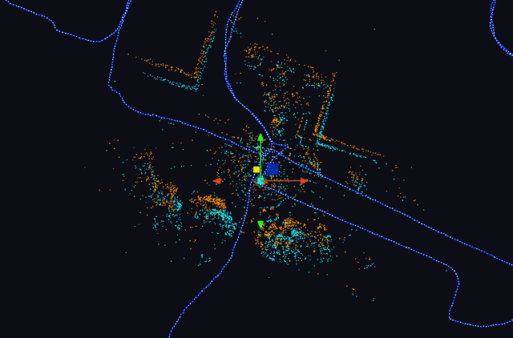</a><br>
  Close a loop in a real campus drive — NCLT, University of Michigan.
</p>

<p align="center">
  <b><a href="https://rsasaki0109.github.io/CloudAnalyzer/app/">Open the app</a></b> ·
  <a href="#try-it">Live demos</a> ·
  <a href="https://rsasaki0109.github.io/CloudAnalyzer/guide.html">Guide</a> ·
  <a href="#proven-on-real-data">Results</a> ·
  <a href="#cli-and-agents">CLI &amp; agents</a>
</p>

<a id="1-fix-the-map"></a>

## Fix SLAM maps

Open ROS bags, MCAP, scans, trajectories or g2o graphs. Build odometry, close loops
and level maps with IMU gravity; inspect and edit with Undo.

<p align="center">
  <a href="scripts/fetch_pandaset.py">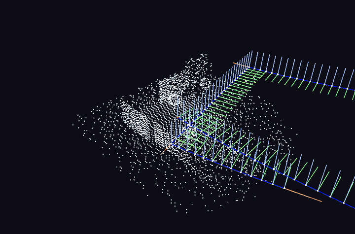</a>
  <a href="scripts/prepare_nclt.py">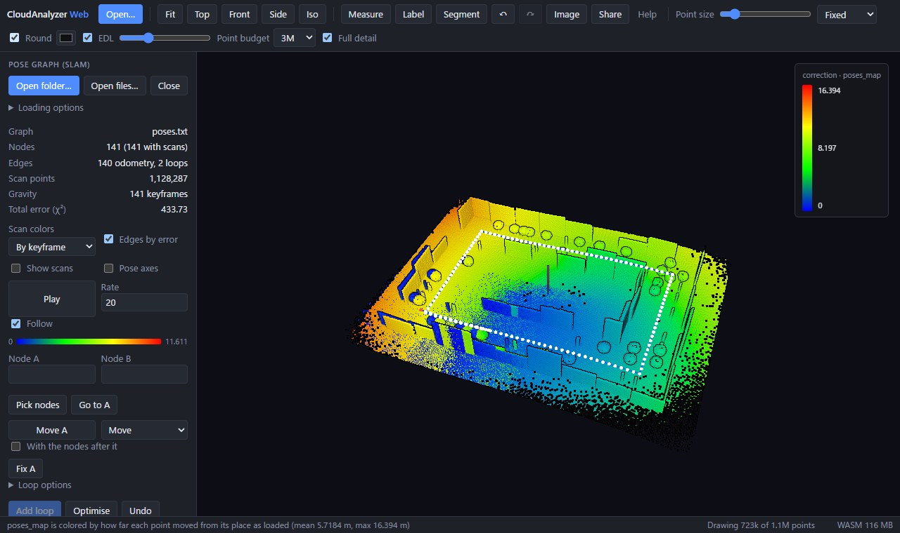</a><br>
  <b>Replay LiDAR</b> — PandaSet, San Francisco. <b>Inspect the correction</b> — NCLT campus.
</p>

- Find loops automatically or align selected keyframes with ICP.
- Join drives, adjust poses and export corrected clouds, KITTI / TUM poses and g2o.
- [Save a project](docs/browser-projects.md) to resume maps, constraints and review notes.

## Build vector maps

Draft roads from points and trajectories, review equipment proposals, and edit
shared boundaries with Undo. Export Autoware Lanelet2 with
[vectormap-rs](https://github.com/rsasaki0109/vectormap-rs).
**Lane counts, object types and legal control require review.**

<p align="center">
  <a href="docs/vector-map-supported-intersection.md">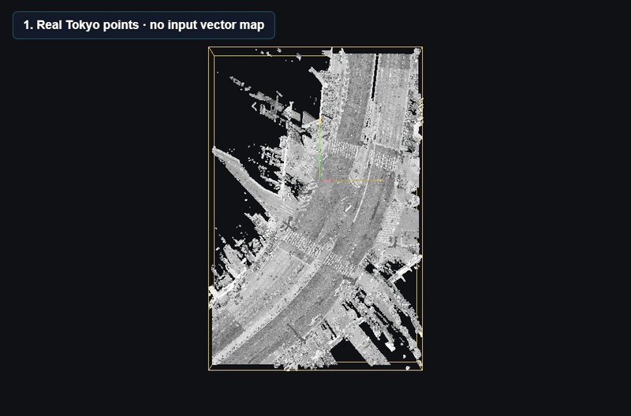</a><br>
  <b>Generate a complex intersection from points. Review, edit, export.</b><br>
  38 road fragments + 21 reviewed connections · 7 crossings · 2 stop drafts · 4 signal housings.<br>
  Source-review flags: 9 → 0; 34.3 m deferred; 2 signals unresolved.<br>
  <a href="docs/vector-map-supported-intersection.md">Source-only workflow, limits and reproduction</a>
</p>

[Road drafting & fitting](docs/commands/vectormap-build.md) ·
[Equipment discovery](docs/commands/vectormap-discover.md) ·
[Source quality](docs/vector-map-quality.md) ·
[Evidence inspection](docs/vector-map-evidence.md)

<details>
  <summary>More vector-map demos</summary>
  <p align="center">
    <a href="docs/vector-map-media.md#source-only-hard-intersection"></a><br>
    Earlier Tokyo draft: nine lanes need <a href="docs/vector-map-quality.md">source review</a>.
  </p>
  <p align="center">
    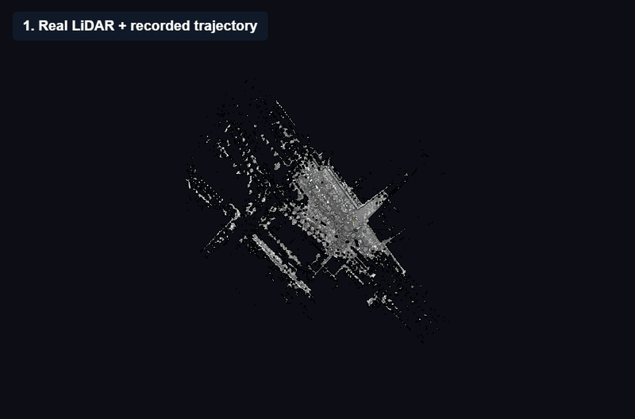<br>
    PandaSet scene 019: draft boundaries from real LiDAR and poses, with editing and Undo.
  </p>
  <p align="center">
    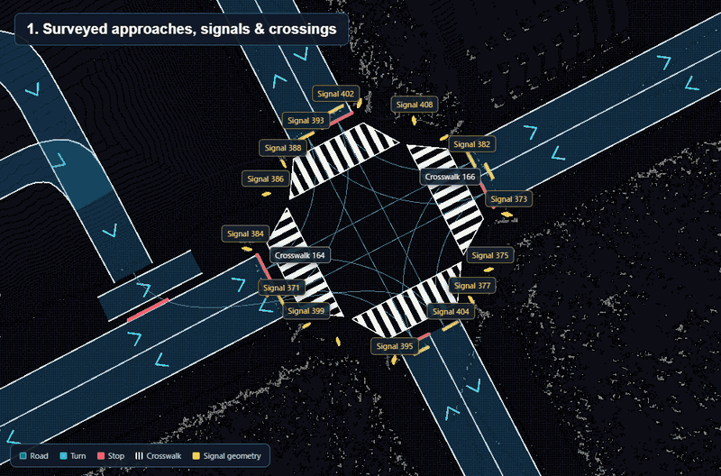<br>
    Surveyed approaches, crossings and signals are imported; this demo drafts connections and edits the existing map.
  </p>
</details>

<a id="2-clean-it-and-see-what-changed"></a>

## Clean and compare

Remove passing traffic, join surveys and inspect changes with M3C2.
Score maps against a reference with accuracy, completeness, F1 and Chamfer.
[Review two-pass changes](docs/survey-change-review.md) with alignment diagnostics,
fixed-camera before/after views and saved human judgments that can be reopened
and resumed against matching comparison contents. Inspect overlapping Lanelet2
lanes after confirming a shared coordinate frame, and save selected lanes as
human follow-up tasks with source snapshots.

<p align="center">
  <a href="scripts/fetch_pandaset.py">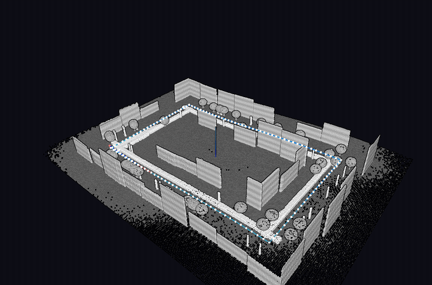</a><br>
  Remove traffic trails from 80 PandaSet scans; retain the static street.
</p>

<p align="center">
  <a href="https://rsasaki0109.github.io/CloudAnalyzer/app/?demo=nclt-seasons">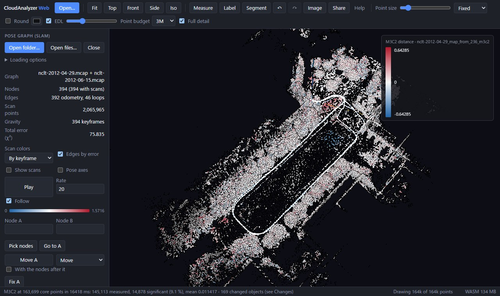</a><br>
  Two ROS 2 bags, one campus block: join April and June, then inspect the changes.
  <a href="https://rsasaki0109.github.io/CloudAnalyzer/app/?demo=nclt-seasons">Try it · 19 MB</a>
</p>

<p align="center">
  <a href="scripts/prepare_nclt.py">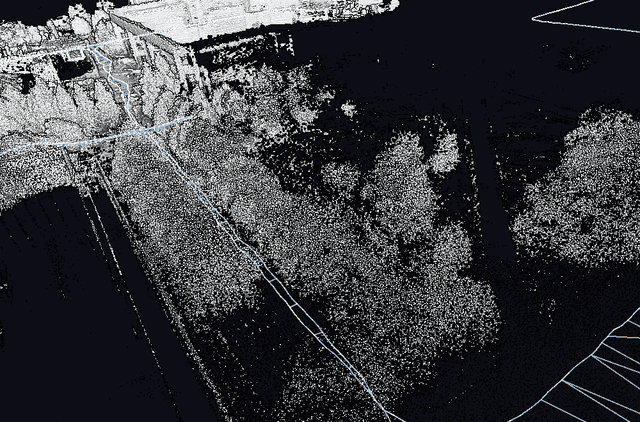</a><br>
  The same NCLT trees in June and December 2012, aligned in the app.
</p>

<a id="3-measure-any-point-cloud"></a>

## Measure point clouds

<table>
  <tr>
    <td width="33%"><a href="https://rsasaki0109.github.io/CloudAnalyzer/app/?demo=c2c">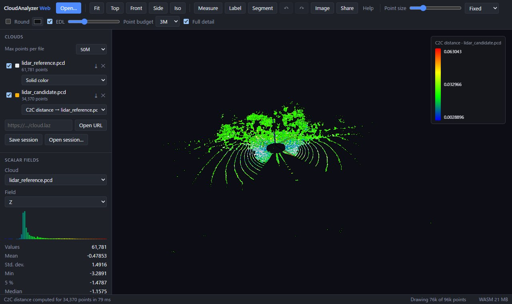</a><br><b>C2C / C2M distance</b></td>
    <td width="33%"><a href="https://rsasaki0109.github.io/CloudAnalyzer/app/?demo=m3c2">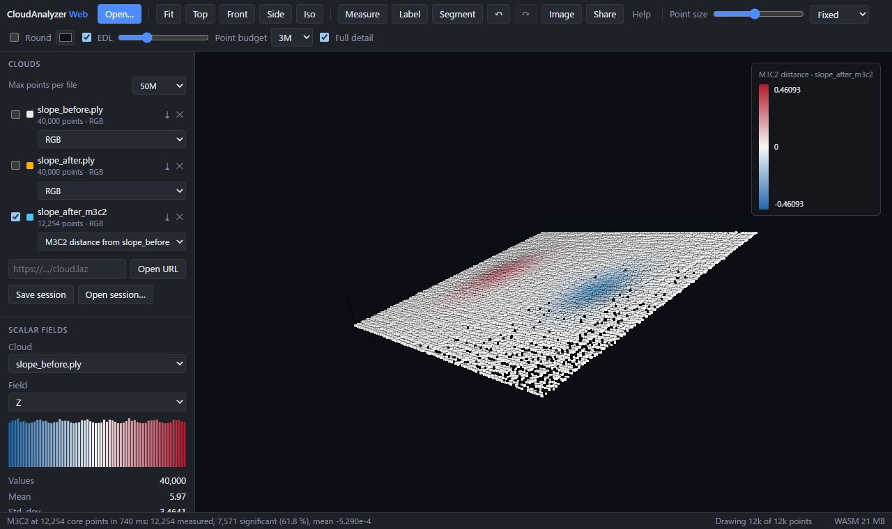</a><br><b>M3C2</b> change detection</td>
    <td width="33%"><a href="https://rsasaki0109.github.io/CloudAnalyzer/app/?demo=volume">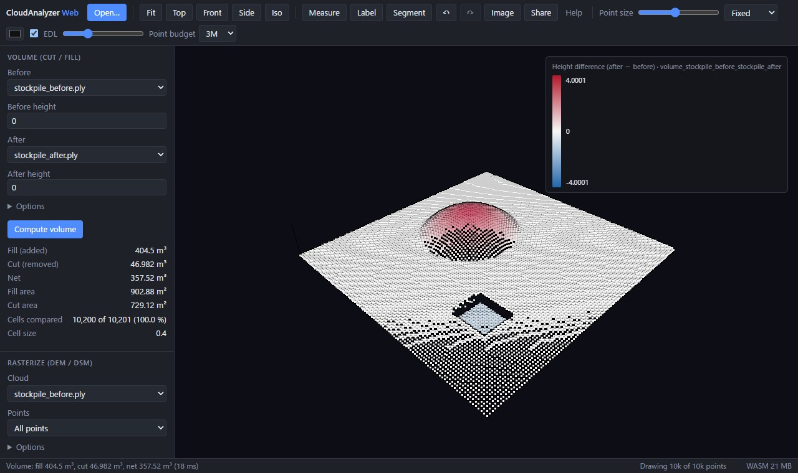</a><br><b>Cut / fill volume</b></td>
  </tr>
  <tr>
    <td><a href="https://rsasaki0109.github.io/CloudAnalyzer/app/?demo=ground">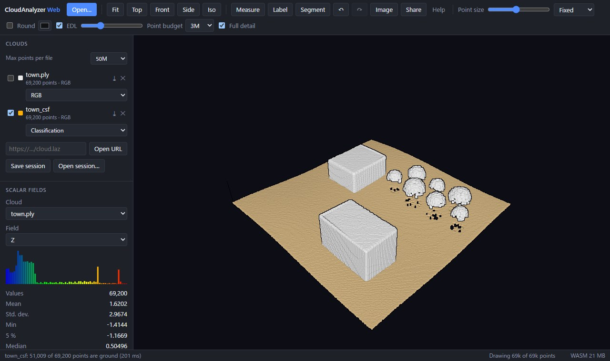</a><br><b>Ground extraction</b> (CSF)</td>
    <td>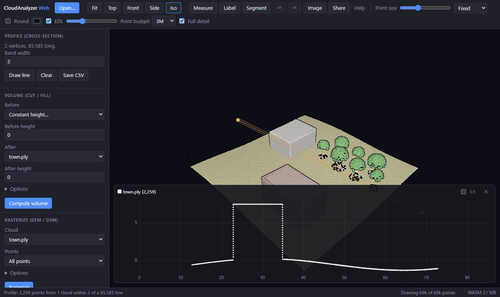<br><b>Cross-sections</b></td>
    <td>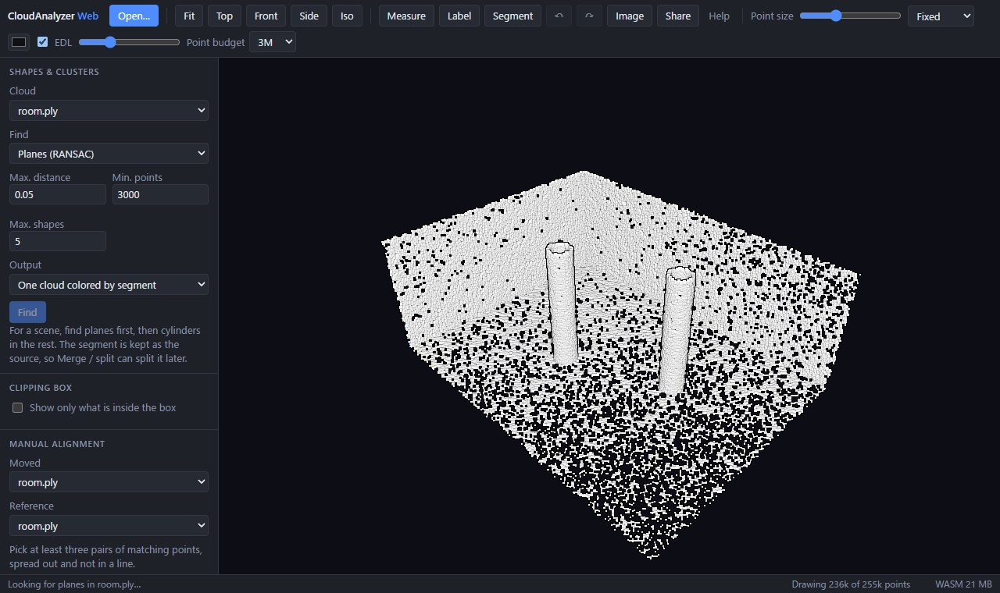<br><b>RANSAC shapes</b> and clustering</td>
  </tr>
</table>

ICP, filtering, normals, meshing, DEM / DSM, scalar fields and trajectory ATE / RPE
are also available. [Explore the tools →](https://rsasaki0109.github.io/CloudAnalyzer/guide.html)

**Open:** PLY, PCD, LAS / LAZ, E57, XYZ, KITTI, OBJ / STL, 3DGS and COPC URLs.
**Save:** PLY, LAS / LAZ, E57, CSV and session links.
For large surveys, see [display LOD vs full-density processing](docs/large-point-clouds.md)
and [resumable COPC tiles](docs/commands/copc-tile.md). Physical ten-billion-point processing remains unbenchmarked.

## Try it

| Demo | Explore |
| --- | --- |
| [Real drive](https://rsasaki0109.github.io/CloudAnalyzer/app/?demo=nclt) | ROS 2 bag, odometry, gravity and loops · 10 MB |
| [Two seasons](https://rsasaki0109.github.io/CloudAnalyzer/app/?demo=nclt-seasons) | Join and compare April / June drives · 19 MB |
| [Loop closure](https://rsasaki0109.github.io/CloudAnalyzer/app/?demo=posegraph) | Find loops and inspect the correction |
| [SLAM drive](https://rsasaki0109.github.io/CloudAnalyzer/app/?demo=posegraph-drive) | Replay, close a loop, remove cars |
| [Two scans](https://rsasaki0109.github.io/CloudAnalyzer/app/?demo=c2c) | Measure cloud-to-cloud distance |
| [Landslide](https://rsasaki0109.github.io/CloudAnalyzer/app/?demo=m3c2) | Inspect M3C2 changes |
| [Stockpile](https://rsasaki0109.github.io/CloudAnalyzer/app/?demo=volume) | Measure cut / fill volume |
| [Town](https://rsasaki0109.github.io/CloudAnalyzer/app/?demo=ground) | Extract ground |

Or drop your files on the [app](https://rsasaki0109.github.io/CloudAnalyzer/app/).

## Proven on real data

KITTI starts from [KISS-ICP](https://github.com/PRBonn/kiss-icp) poses;
correction adds loops and IMU gravity. The NCLT result uses loop closure.

| Trajectory ATE (RMSE) | Before | Corrected |
| --- | ---: | ---: |
| KITTI 00 · 3.7 km | 22.3 m | **5.8 m** |
| KITTI 07 | 2.14 m | **1.16 m** |
| KITTI 09 | 16.4 m | **2.3 m** |
| NCLT 2012-04-29 · 3.2 km, SE(3)-aligned | 4.83 m | **1.64 m** |

KITTI map F1 at 0.3 m: **0.45 → 0.70** (07), **0.16 → 0.42** (09).
[Benchmark tutorial](docs/tutorial-slam-benchmark.md) ·
[Leaderboard](https://rsasaki0109.github.io/CloudAnalyzer/leaderboard/)

<a id="ca-the-ci-command-line"></a>
<a id="ca-the-command-line-for-ci-and-ai-agents"></a>

## CLI and agents

The same Rust core runs natively through `ca`, with JSON metrics, HTML reports
and CI pass/fail gates. Read bags, MCAP and rosbag2 SQLite without installing ROS.

```bash
pip install "cloudanalyzer[fast]"
ca posegraph-fix drive.mcap --out fixed/ --remove-dynamic --keyframe-spacing 1
ca web-view fixed/
ca posegraph-compare june/ december/ --here 1219 --there 850 --out changes/
```

[AI agents over MCP](docs/commands/mcp.md) can inspect inputs and run the same tools.
[Agent-driven mapping](docs/commands/mapping-run.md) builds point-cloud maps and
HD-road drafts from recordings and an explicit lane layout, with recorded choices
and resumable repairs.

[CLI reference](cloudanalyzer/) · [Commands](docs/commands/) ·
[CI & quality gates](docs/ci.md) · [Mapping tools](docs/commands/mapping-job.md)

## Develop

```sh
cd web
npm install
npm run wasm
npm run dev
```

[`web/`](web/) — TypeScript / three.js app · [`rust/`](rust/) — Rust core / WASM / Python bindings ·
[`cloudanalyzer/`](cloudanalyzer/) — Python CLI

Tests: `cargo test` in `rust/`, `npx playwright test` in `web/`.
Media: `npm run media` after `npm run build` in `web/`.

## License

[MIT](LICENSE). Demo data and derived images retain their upstream terms:
[image attribution](docs/images/ATTRIBUTION.md) · [sample attribution](web/public/samples/ATTRIBUTION.md).
Real-drive imagery includes NCLT (University of Michigan, ODbL) and PandaSet (Scale AI and Hesai, CC BY 4.0).
KITTI data is not redistributed.
