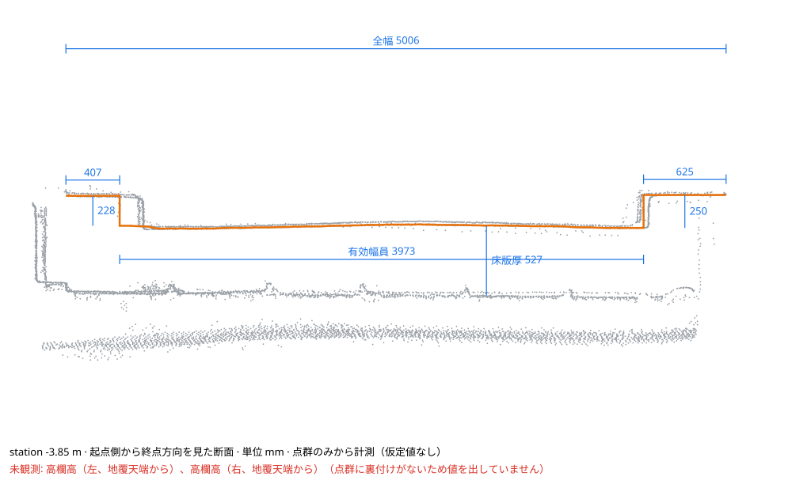
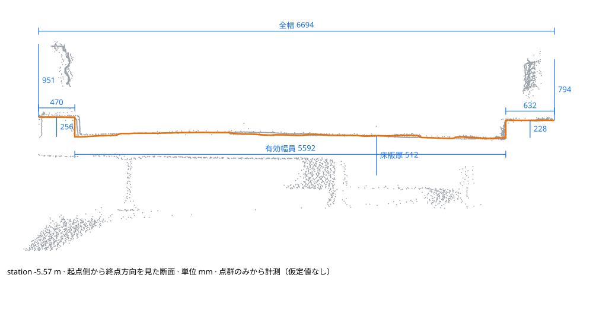
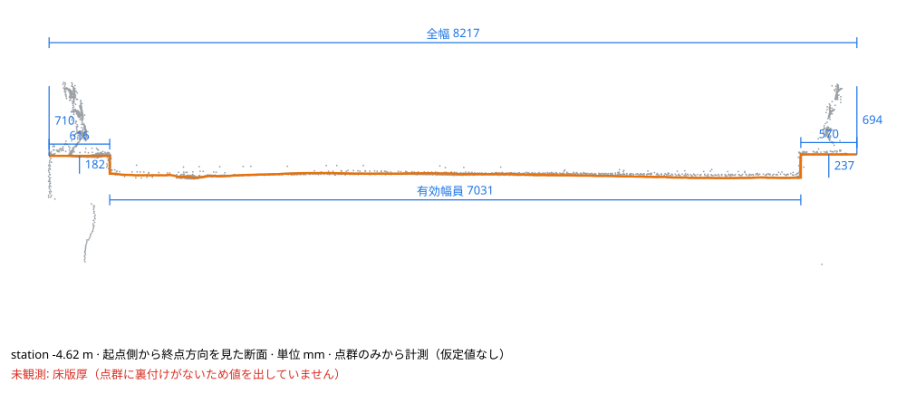
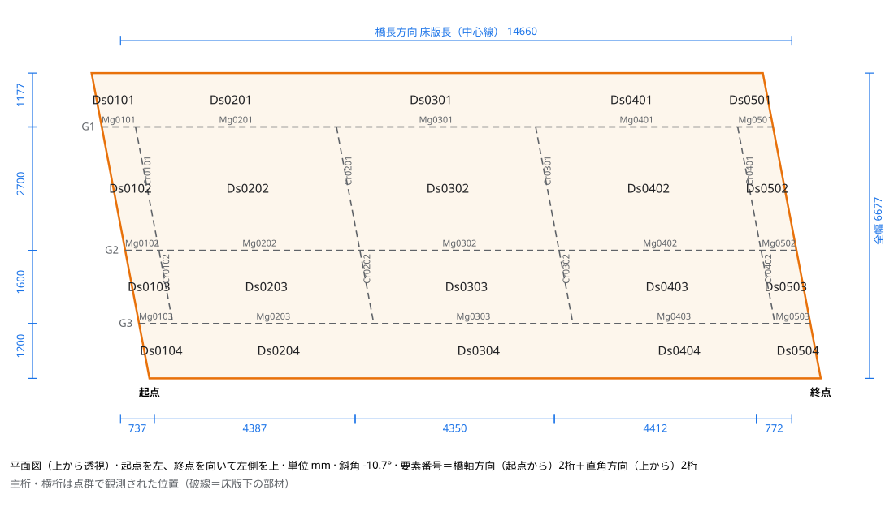
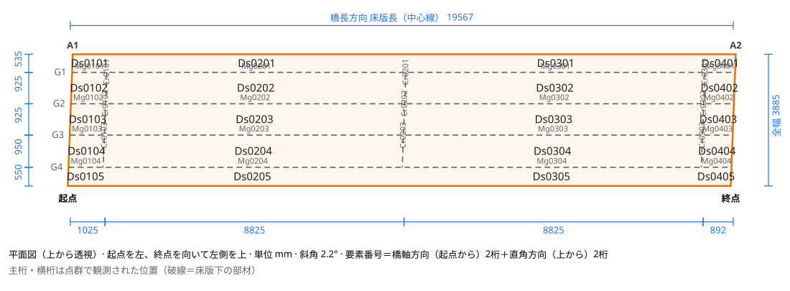
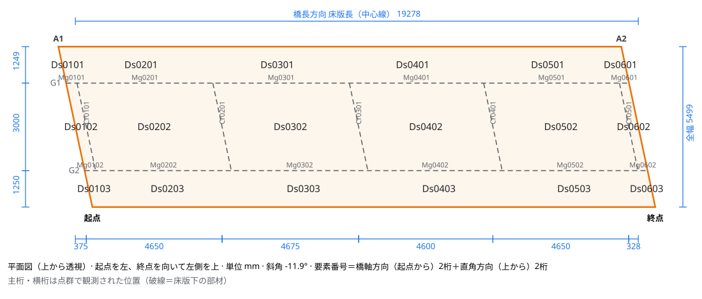
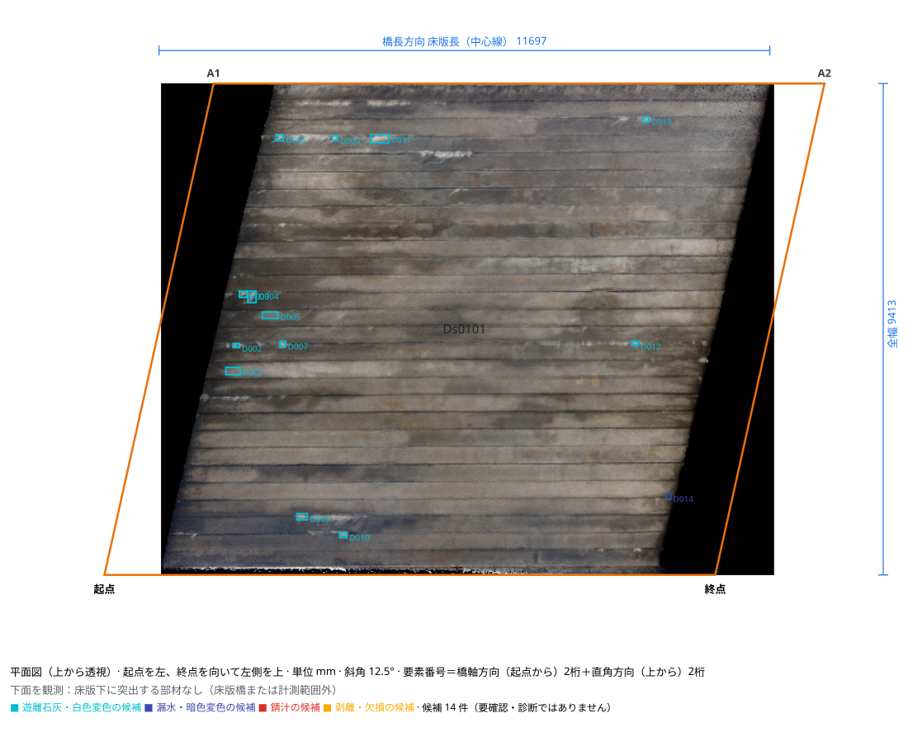
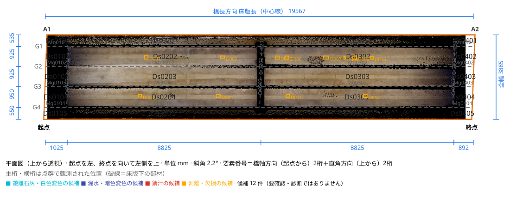

# Bridge sections on three public reinforced-concrete bridges

`ca bridge-sections` cut cross sections every 1 m along three bridges of the
public [Point Cloud Dataset of Reinforced Concrete Bridges Captured with Matterport
Pro3 Scanner in Japan](https://doi.org/10.6084/m9.figshare.28091453.v2)
(Pang-jo Chun, Chao Lin, Tatsuro Yamane, Shiori Kubo, Yu Chen; CC BY 4.0) and
aggregated a member dimension table. The scans are local metres with 1 mm
coordinate resolution; the scanner's stated accuracy is ±20 mm at 10 m.

```bash
ca bridge-sections Bridge_4.las -o bridge_4 --classes 0,1,2,3 --axis-classes 2
```

`--classes 0,1,2,3` keeps the dataset's abutment, girder, deck and parapet labels
and drops class 4 (vegetation, terrain, utilities). `--axis-classes 2` takes the
axis and the skewed deck ends from the deck points. The labels select points
only; every dimension below is measured from geometry. The point clouds are not
committed: each `bridge_sections.json` records the source file's SHA-256.

| Median (p10–p90) | Bridge_2 | Bridge_4 | Bridge_5 |
|---|---:|---:|---:|
| Sections measured | 9 / 9 | 14 / 14 | 14 / 14 |
| Deck length on the centreline (m) | 9.428 | 14.660 | 15.876 |
| Skew (°) | 0.3 | −10.7 | −17.0 |
| Total width (m) | 5.015 (4.970–5.043) | 6.683 (6.646–6.712) | 8.218 (8.098–8.235) |
| Effective width between curbs (m) | 3.870 (3.462–3.985) | 5.585 (5.540–5.624) | 7.030 (6.895–7.037) |
| Crown height (m) | 0.034 | 0.074 | 0.025 |
| Cross slope left / right (%) | −2.3 / 2.3 | −2.7 / 2.5 | −1.5 / 1.0 |
| Curb width left / right (m) | 0.568 / 0.578 | 0.502 / 0.600 | 0.613 / 0.586 |
| Curb height left / right (m) | 0.252 / 0.250 | 0.246 / 0.239 | 0.219 / 0.236 |
| Parapet height left / right (m) | unobserved | 0.953 / 0.924 | 0.701 / 0.675 |
| Visible outer-face depth left / right (m) | ≥ 0.442 / ≥ 0.438 | ≥ 0.283 / ≥ 0.339 | ≥ 0.258 / ≥ 0.284 |
| Slab thickness (m) | 0.498 (0.478–0.550) | 0.302 (0.287–0.331) | unobserved |

The widths are measured independently, yet effective width plus both curb widths
reproduces the total width within 1–11 mm on every bridge. Bridge_5 was scanned
from the deck only: there are no returns beneath it, so its slab thickness is
reported as unobserved instead of an assumed value. Bridge_2 carries no parapet
points, and its parapet heights are unobserved for the same reason. Outer-face
depths are visible extents below the deck top, lower bounds rather than member
depths.

| Bridge_2 | Bridge_4 | Bridge_5 |
|---|---|---|
|  |  |  |

## Plans with numbered elements

`ca bridge-plan` drew the plan of all nine bridges in the dataset for damage-map bases:

```bash
ca bridge-plan Bridge_4.las -o bridge_4 --classes 0,1,2,3 --axis-classes 2 --member-classes 1,2
```

`--member-classes 1,2` searches the girder and deck labels for members and leaves
out the abutment walls under the deck ends. Bridges 1, 3 and 6–9 have only plan
outputs here.

| Bridge | Deck (m) | Skew (°) | Underside | Girders (lateral offset, m) | Cross beams (from the start, m) | Spans | Elements |
|---|---|---:|---|---|---|---:|---|
| Bridge_1 | 5.37 × 4.56 | -0.3 | scanned, nothing below the slab | – | – | 1 | 1 Ds |
| Bridge_2 | 9.43 × 5.02 | 0.3 | scanned, nothing below the slab | – | – | 1 | 1 Ds |
| Bridge_3 | 11.70 × 9.41 | 12.5 | scanned, nothing below the slab | – | – | 1 | 1 Ds |
| Bridge_4 | 14.66 × 6.68 | -10.7 | girders observed | +2.17, -0.53, -2.13 | 0.74, 5.12, 9.47, 13.89 | 1 | 20 Ds · 15 Mg · 8 Cr |
| Bridge_5 | 15.88 × 8.19 | -17.0 | not scanned | – | – | 1 | 1 Ds |
| Bridge_6 | 16.53 × 8.27 | 8.3 | scanned, nothing below the slab | – | – | 1 | 1 Ds |
| Bridge_7 | 19.57 × 3.89 | 2.2 | girders observed | +1.42, +0.50, -0.43, -1.38 | 1.03, 9.85, 18.68 | 1 | 20 Ds · 16 Mg · 9 Cr |
| Bridge_8 | 19.28 × 5.50 | -11.9 | girders observed | +1.49, -1.51 | 0.38, 5.03, 9.70, 14.30, 18.95 | 1 | 18 Ds · 12 Mg · 5 Cr |
| Bridge_9 | 25.42 × 6.49 | 22.5 | girders observed | +2.01, +1.39, -0.19, -2.34 | 6.25, 11.88, 17.53, 23.23 | 1 | 25 Ds · 20 Mg · 12 Cr |

All nine are single-span: their elevations show abutments at both ends and no pier,
and no pier is reported on any of them. The plan's deck length, width and skew agree
with the cross-section table above (Bridge_4: 14.660 m, 6.677 m against a 6.683 m
total width, −10.7°). Bridge_4's and Bridge_7's cross beams nearest the ends lie
0.7–1.0 m inside the deck ends; with the abutment labels left out they are returns
labelled as girder, most likely end cross beams. Bridge_9's first two girders are only
0.62 m apart, unlike its other spacings; the second is seen in 75 of 91 sections and
was not confirmed by eye, so check it before relying on that bridge's numbers.
Bridge_6's deck labels include a few points over the approach beyond a 2.5 m gap;
the deck ends leave them out (16.53 m instead of 20.83 m).

| Bridge_4 | Bridge_7 | Bridge_8 |
|---|---|---|
|  |  |  |

## Damage candidates on the soffit

`ca bridge-damage` searched the soffit of the eight bridges whose underside was
scanned (not Bridge_5) and placed the candidates on the plans above:

```bash
ca bridge-damage Bridge_3.las -o bridge_3 --classes 0,1,2,3 --axis-classes 2 --member-classes 1,2 --surface-classes 1,2
```

| Bridge | Soffit searched (m²) | Light | Dark | Rust | Recess | Straight seams left out (m) |
|---|---:|---:|---:|---:|---:|---:|
| Bridge_1 | 9.2 | 1 | 3 | 0 | 2 | 68 |
| Bridge_2 | 32.2 | 1 | 1 | 0 | 0 | 210 |
| Bridge_3 | 82.4 | 12 | 1 | 0 | 0 | 72 |
| Bridge_4 | 45.6 | 0 | 1 | 0 | 0 | 8 |
| Bridge_6 | 113.4 | 0 | 4 | 0 | 0 | 197 |
| Bridge_7 | 11.6 | 0 | 0 | 0 | 12 | 4 |
| Bridge_8 | 51.5 | 1 | 0 | 0 | 1 | 9 |
| Bridge_9 | 30.5 | 0 | 1 | 2 | 1 | 52 |

No inspection records come with the dataset, so how many candidates are real is
unknown. By eye on the orthophotos, Bridge_3's light candidates sit on white
deposits between its formwork lines, and Bridge_7's recess candidates on a rough,
darker patch in one girder bay. Bridges 2 and 6 had about 200 m of straight joints
and seams that would otherwise have been candidates. Bridge_1 has 6 candidates on
9 m² searched and was not checked by eye.

Checking candidates on the SemanticBridge scans (see
[`semanticbridge-tls`](../semanticbridge-tls/README.md#damage-candidates)) led to three
more exclusions: a band beside joints, sparse stretches and, for recess, soffit steps.
With them the eight bridges here went from 83 candidates to 44, mostly fewer recess
and dark ones (Bridge_1 30 to 6, Bridge_9 13 to 4). Bridge_3's light candidates
(13 to 12) and Bridge_7's recess candidates (14 to 12) stayed. `damage.json` and `damage.csv` are
committed for all eight, the drawings for two:

| Bridge_3 | Bridge_7 |
|---|---|
|  |  |

## Limits

- No reference dimensions were available, so these are measurements, not an
  accuracy evaluation. The p10–p90 spread includes real variation along each
  bridge, scanner noise and section placement.
- Slab thickness is the first surface beneath the deck top: on a girder bridge
  it is measured between girders only when the underside was scanned.
- Bearings and abutment dimensions are not measured yet. No bridge here has a
  pier, so pier detection is tested only on synthetic bridges.
- A deck that the labels do not separate from overhanging vegetation needs
  `--classes` or cropping; without labels the deck is still the highest long
  smooth surface, but trees above it are not guaranteed to be excluded.
