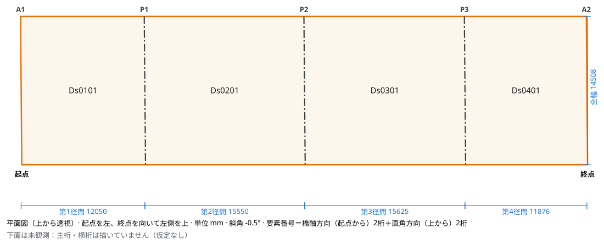
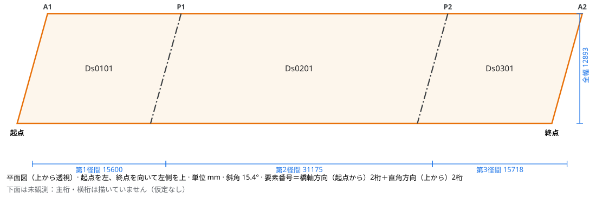
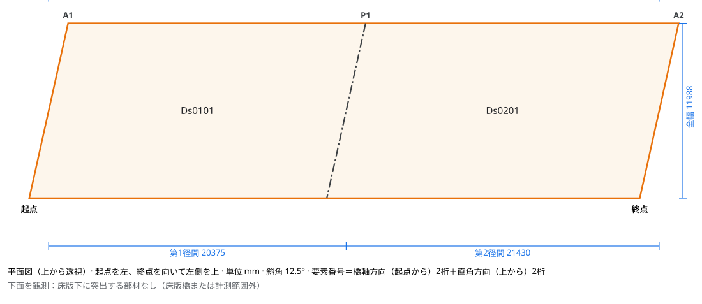

# Piers on the SemanticBridge TLS bridges

[SemanticBridge](https://zenodo.org/records/18738225) (CC BY 4.0) holds terrestrial
laser scans of 20 bridges with a label on every point: 10 in Cambridgeshire (`cb`)
and 10 in France (`fr`). The paper ([arXiv 2512.15369](https://arxiv.org/abs/2512.15369),
doi:10.1016/j.dibe.2026.100912) lists each bridge's spans; 14 have two to four. This
benchmark checks the piers that `ca bridge-plan` detects against the `Pillar` labels.

The PLY files of `tls_dataset.zip` (md5 `44994e825b9ca5ec0fa7c3bdcff00960`) were
converted to LAS with their colour and labels, and the plans drawn with:

```bash
ca bridge-plan bridge_6_cb.las -o bridge_6_cb --classes 3,4,5,8 --axis-classes 5 --member-classes 4
```

`--classes 3,4,5,8` keeps the abutment, superstructure, deck and pillar labels. The
dataset's railing class also covers barriers beneath the bridge. On bridge_18_fr,
railing-labelled structure across the width below the deck is otherwise reported as a pier.

The labelled pier positions are the medians of pillar returns grouped along the
skewed axis (returns more than 2 m apart are separate piers), measured from the start
of the deck like the detected ones. A detected pier within 1 m of a labelled one counts as
found. [`piers.json`](piers.json) holds the positions, errors and spans per bridge.

## Results

| | |
|---|---|
| Labelled piers | 33 on 14 bridges |
| Found | 32 (mean position error 0.15 m, at most 0.79 m) |
| Reported where there is none | 1 |
| Single-span bridges with a pier reported | 0 of 6 (and 0 of the 9 in [`figshare-rc-bridges`](../figshare-rc-bridges/README.md)) |
| Bridges with the right number of spans | 18 of 20 |

| Bridge | Deck (m) | Skew (°) | Underside | Labelled piers (m from start) | Detected piers | Spans (paper) | Detected span lengths (m) | Paper span lengths (m) |
|---|---|---:|---|---|---|---|---|---|
| bridge_1_cb | 62.86 × 8.41 | 38.5 | scanned, nothing below 0.2 m | 12.36, 31.41, 50.49 | 12.25, 31.40, 50.50 | 4 (4) | 12.25, 19.15, 19.10, 12.36 | 12.17, 19.04, 18.86, 12.58 |
| bridge_2_cb | 54.38 × 11.61 | -6.1 | scanned, nothing below 0.2 m | 12.30, 27.30, 42.21 | 12.20, 27.20, 42.17 | 4 (4) | 12.20, 15.00, 14.97, 12.20 | 11.80, 14.79, 14.95, 12.28 |
| bridge_3_cb | 53.10 × 11.99 | -0.1 | scanned, nothing below 0.2 m | 11.53, 26.72, 41.59 | 11.55, 26.55, 41.58 | 4 (4) | 11.55, 15.00, 15.03, 11.52 | 11.31, 14.91, 14.80, 11.35 |
| bridge_4_cb | 35.01 × 27.63 | 5.3 | not scanned | 9.50, 24.08 | 9.50, 24.15 | 3 (3) | 9.50, 14.65, 10.86 | 8.27, 14.42, 9.78 |
| bridge_5_cb | 62.49 × 12.89 | 15.4 | not scanned | 15.56, 46.74 | 15.60, 46.77 | 3 (3) | 15.60, 31.17, 15.72 | 15.04, 30.77, 15.61 |
| bridge_6_cb | 55.10 × 14.51 | -0.5 | not scanned | 12.13, 27.54, 43.22 | 12.05, 27.60, 43.23 | 4 (4) | 12.05, 15.55, 15.63, 11.88 | 11.93, 15.38, 15.54, 11.54 |
| bridge_7_cb | 40.42 × 11.71 | -3.2 | girders observed | 18.19 | 18.48 | 2 (2) | 18.48, 21.94 | 18.15, 21.76 |
| bridge_8_cb | 53.02 × 9.44 | 10.7 | scanned, nothing below 0.2 m | 10.76, 25.49, 40.17 | 10.65, 25.50, 40.33 | 4 (4) | 10.65, 14.85, 14.83, 12.69 | 10.46, 14.71, 14.80, 12.77 |
| bridge_9_cb | 52.93 × 12.28 | -1.1 | scanned, nothing below 0.2 m | 12.91, 27.57, 42.14 | 12.90, 27.60, 42.20 | 4 (4) | 12.90, 14.70, 14.60, 10.73 | 12.67, 14.54, 14.80, 10.17 |
| bridge_10_cb | 72.14 × 8.13 | 25.9 | girders observed | 16.21, 36.38, 53.71 | 17.00, 35.72, 54.37 | 4 (4) | 17.00, 18.72, 18.65, 17.77 | 16.20, 18.74, 18.58, 16.07 |
| bridge_11_fr | 16.73 × 6.55 | -19.1 | girders observed | – | – | 1 (1) | 16.73 | – |
| bridge_12_fr | 41.02 × 7.55 | -2.3 | scanned, nothing below 0.2 m | – | – | 1 (1) | 41.02 | – |
| bridge_13_fr | 27.29 × 2.30 | 2.3 | girders observed | – | – | 1 (1) | 27.29 | – |
| bridge_14_fr | 14.88 × 11.20 | 1.4 | scanned, nothing below 0.2 m | – | – | 1 (1) | 14.88 | – |
| bridge_15_fr | 18.28 × 4.55 | 16.3 | scanned, nothing below 0.2 m | – | – | 1 (1) | 18.28 | – |
| bridge_16_fr | 45.55 × 9.27 | -19.3 | scanned, nothing below 0.2 m | – | – | 1 (1) | 45.55 | – |
| bridge_17_fr | 41.81 × 11.99 | 12.5 | scanned, nothing below 0.2 m | 19.87 | 20.38 | 2 (2) | 20.38, 21.43 | 20.41, 21.31 |
| bridge_18_fr | 37.10 × 12.42 | 18.2 | not scanned | 11.65, 24.96 | 11.78, 24.83 | 3 (3) | 11.78, 13.05, 12.28 | 11.73, 13.60, 12.61 |
| bridge_19_fr | 35.59 × 9.08 | 16.4 | not scanned | 11.08, 24.57 | 11.18 | 2 (3) | 11.18, 24.42 | 11.23, 13.11, 10.89 |
| bridge_20_fr | 40.75 × 11.88 | 12.2 | girders observed | 14.17, 27.59 | 5.25, 14.43, 27.73 | 4 (3) | 5.25, 9.18, 13.30, 13.03 | 12.71, 12.98, 14.46 |

The paper's span lengths are given in the direction of the detected axis where that fits
better; they are measured between bearings or pier centres in a way the paper does not
state, so the labelled pier positions are the reference here.

The plan's deck width is within 0.5 m of the paper's width on 10 bridges and within
1 m on 13, with a median difference of 0.52 m. Before raised edges were followed past
1.2 m as footways, those figures were 4, 5 and 1.83 m.

The width is more than 1 m short on bridge_1_cb, bridge_10_cb, bridge_14_fr,
bridge_18_fr, bridge_19_fr and bridge_20_fr. On these, the deck top near its edges was
seen little or not at all, or the edge has no raised curb or footway to follow.
bridge_20_fr's deck is 22.9 m wide, and only part of it is found. bridge_11_fr comes
out 1.28 m wider than the paper's 5.27 m; this was not looked into.

Two bridges are wrong:

- **bridge_20_fr** reports a pier 5.25 m from the start. That is the front wall of
  an abutment that stands 5 m inside the deck end. With the ground not among the
  classes, the wall looks like a wall pier with open space on both sides.
- **bridge_19_fr** misses its second pier. Its returns merge with a deep superstructure
  diaphragm over the pier into one run 2.75 m long whose upper half stands 0.45 m off
  its lower half.

| bridge_6_cb (piers of columns) | bridge_5_cb | bridge_17_fr |
|---|---|---|
|  |  |  |

## Before the change

The same run with the previous support rules found 18 of the 33 piers, with no
false reports. These are the rules that changed, and the bridges each one had missed:

| Previous rule | Bridges missed |
|---|---|
| Filled 30% of the deck width, so a row of two or three columns did not count | 6, 10, 18, 19 |
| Searched only between the measured deck edges | 10, whose columns stood just outside its narrowly measured deck |
| Was at most 3 m long | 4, whose 3.2 m pier was too long |
| Kept only bins with a tenth of the densest bin's returns | 17, 19, 20, whose dense abutment faces hid parts of the piers and made their sides look occupied |

The 1 m threshold for a found pier is generous against the 0.15 m mean error. All
errors are within 0.3 m except four: bridge_10_cb's three (0.65–0.79 m, on a 26° skew
with two columns per pier) and bridge_17_fr's (0.51 m).

## Damage candidates

`ca bridge-damage` searched the soffit of the 15 bridges whose underside was scanned,
on the plans above, with the superstructure and deck labels as the surface:

```bash
ca bridge-damage bridge_2_cb.las -o bridge_2_cb --classes 3,4,5,8 --axis-classes 5 --member-classes 4 --surface-classes 4,5
```

There are no inspection records, so the candidates were checked by eye on the coloured
points and a height map around each. With the rules before this check they numbered 56.
Almost all were explained by three things the search had not left out:

| Cause | Where | What the search now does |
|---|---|---|
| A joint's receded groove beside its dark line | 6 of bridge_1_cb's 10 recess candidates, along its longitudinal joints | Leaves out a 0.2 m band beside a straight seam of any kind, for every kind |
| Sparse returns far from the scanner or between scan lines | bridge_1_cb's other 4 and 7 of bridge_2_cb's 11 (neighbourhoods 44–51% filled) | Searches a cell only where at least half of its 0.5 m neighbourhood has returns |
| Steps in the soffit (haunches, beam edges at a skew) | the remaining recess candidates on bridge_9_cb, bridge_12_fr, bridge_13_fr and bridge_16_fr | Searches recess only where the neighbourhood's height interquartile range is at most 2.4 cm |

With these the 15 bridges have 9 candidates on 1 495 m² searched (87 m² left out as too
sparse). By eye:

- **Plausible:** a light patch on bridge_2_cb (D003) and a dark mottled stain on
  bridge_10_cb (D003).
- **Not damage:**
  - bridge_10_cb's other three sit beside a beam edge at a skew.
  - bridge_17_fr's two sit on a diamond mesh hanging below the soffit, perhaps netting.
- **Not looked into:** bridge_2_cb's other two.

bridge_7_cb and bridge_11_fr have girders so close that nothing between them is left to
search. Girder faces are not searched.

| Bridge | Searched (m²) | Too sparse (m²) | Candidates before | Candidates now |
|---|---:|---:|---:|---:|
| bridge_1_cb | 200.0 | 3.0 | 10 | 0 |
| bridge_2_cb | 348.1 | 15.7 | 11 | 3 |
| bridge_3_cb | 400.6 | 6.1 | 0 | 0 |
| bridge_7_cb | 0.0 | 0.0 | 0 | 0 |
| bridge_8_cb | 173.4 | 20.2 | 0 | 0 |
| bridge_9_cb | 40.4 | 15.3 | 9 | 0 |
| bridge_10_cb | 77.5 | 2.3 | 5 | 4 |
| bridge_11_fr | 0.0 | 0.0 | 0 | 0 |
| bridge_12_fr | 20.8 | 0.4 | 6 | 0 |
| bridge_13_fr | 15.0 | 1.6 | 6 | 0 |
| bridge_14_fr | 61.0 | 3.2 | 0 | 0 |
| bridge_15_fr | 0.0 | 0.4 | 0 | 0 |
| bridge_16_fr | 25.2 | 8.7 | 6 | 0 |
| bridge_17_fr | 117.9 | 9.4 | 3 | 2 |
| bridge_20_fr | 15.5 | 1.1 | 0 | 0 |
| **Total** | **1495** | **87** | **56** | **9** |
