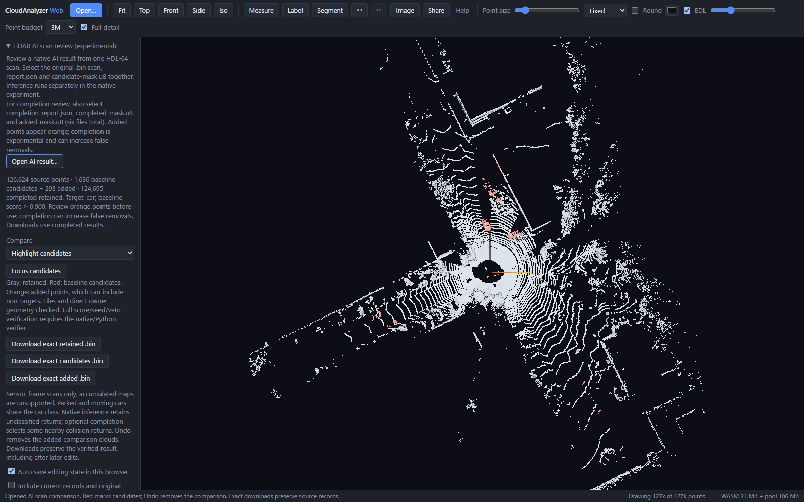
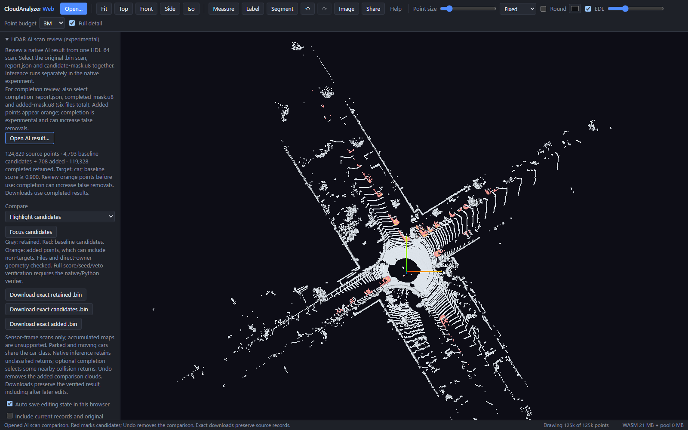

# Review native AI candidates and experimental additions

The browser can now compare a frozen nearest-only AI result with the separate
completion experiment. **Gray** is the completed retained scan, **red** is the
original AI selection, and **orange** is the additional selection. Orange is not
a ground-truth label: it can include non-car points.

In **Clouds → LiDAR AI scan review**, select exactly six files together:

1. The original KITTI scan `.bin`.
2. Native `report.json` and `candidate-mask.u8`.
3. `completion-report.json`, `completed-mask.u8` and `added-mask.u8`.

Compare the original scan, completed retained scan, highlighted selections, all
candidates, baseline candidates only or additions only. Focus follows the
selected candidate view. The comparison is one Undo/Redo operation. Exact
downloads provide completed retained/candidate records and a separate `added.bin`;
later viewer edits do not change these original verified downloads. The native
three-file workflow still works and rejects completion files on its own.

## Actual frozen scans

| Sequence 08 frame | Original candidates | Added selection | Completed candidates | Annotation audit of additions |
| --- | ---: | ---: | ---: | --- |
| 001000 | 1,636 | 293 | 1,929 | 281 car + 12 motorcycle |
| 002500 | 4,793 | 708 | 5,501 | 708 car + 0 non-car |

Both actual browser runs preserve exact source records in all three downloads,
leave the source unchanged, restore the added-only view after Undo/Redo and
report no browser errors. Annotation counts come from the earlier frozen audit;
the browser receives no annotations and measures no detection accuracy.

## Why the failed cases stay experimental

Tracing **all 14 additional false removals** from the
[frozen six-frame comparison](../near-surface-completion/README.md) reveals two
different failure modes:

- **Frame 000000, two road points:** the original pixel owners are annotated
  moving-car points, 13.43–13.65 cm away. Each road point also has an eligible
  second annotated car seed. Even two semantically correct car seeds can extend
  across a nearby object boundary. One supporting road seed is itself predicted
  as car, too.
- **Frame 001000, twelve motorcycle points:** every direct owner is also an
  annotated motorcycle, predicted as car at score ≥0.99. No eligible supporting
  seed is an annotated car. Agreement among confident predictions does not
  correct their shared class error.

No confident different-class neighbor vetoes these additions. These are
post-hoc explanations of the existing failures, not a new evaluation or a tuned
rule. The two failed gates, policy, predictions, masks and default stay unchanged.

## Verification scope

The reader checks the strict native baseline, source/model/selection bindings,
report and mask hashes, additive/disjoint mask consistency, projection
ownership, direct-owner distance and exact completed source-record splits.
All six frozen frames match their native completed outputs. Probability tensors
are not loaded: full seed-score, second-seed and class-veto verification remains
in the native command and independent Python oracle.

`verification.json` binds the source/build, six reader checks and both actual
browser receipts. `failure-analysis.json` and `false-removal-traces.json` retain
all failed additions' class/score/distance evidence, without raw XYZI records.
Local checks: 113 Web unit tests, TypeScript/Vite build, four completion browser
cases, six existing native-review cases and six C2C/lane-review regressions pass.

No new inference, training, parameter search or dataset download was needed.
No raw scans, annotation files, tensors, weights or generated point files are
distributed here. Screenshots show the actual browser rendering. Small related
validation scans do not establish held-out accuracy or safe whole-car removal.
