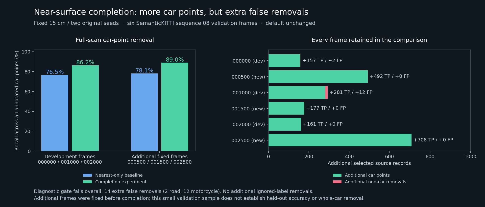

# Near-surface completion experiment

**Keep the nearest-only default.** The fixed completion rule recovers more car
points, but adds 14 labeled false removals in two development frames. It remains
a separate opt-in CPU command with distinct output/report names.

| Fixed group | Nearest-only car recall | Completed car recall | Additional car points | Additional non-car removals | Additional ignored removals |
| --- | ---: | ---: | ---: | ---: | ---: |
| Development: 000000, 001000, 002000 | 76.54% | 86.23% | 599 | 14 | 0 |
| Additional: 000500, 001500, 002500 | 78.13% | 88.99% | 1,377 | 0 | 0 |

All scans are from SemanticKITTI validation sequence 08. Development frames
were inspected in the previous quality investigation. The additional frame IDs
were fixed before their inference/completion results. This split may have
informed the published model checkpoint; these are not independent held-out
model-accuracy results.

| Frame | Group | Added car points | Added non-car removals | Fixed diagnostic gate |
| --- | --- | ---: | ---: | --- |
| 000000 | Development | 157 | 2 road | Fail |
| 001000 | Development | 281 | 12 motorcycle | Fail |
| 002000 | Development | 161 | 0 | Pass |
| 000500 | Additional | 492 | 0 | Pass |
| 001500 | Additional | 177 | 0 | Pass |
| 002500 | Additional | 708 | 0 | Pass |

The gate requires additional labeled car points, no added labeled non-car
removals and no added ignored-label removals **in every frame**. It fails
overall; both failed cases remain in the packet. Higher pooled precision does
not excuse the absolute false-removal increase. No parameters were adjusted
after seeing these completion results.

## Rule and scope

The candidate must be a finite, supported sensor-frame return that lost a
projection collision. Its original pixel owner and a second original owner
must predict the same target class at score ≥0.99. Both must lie within 15 cm
of the candidate and be at least 2 cm apart. Any different-class original owner
at score ≥0.90 within 15 cm vetoes it. Neighborhoods over 256 owners abstain.
Added points never become seeds, and original owner decisions never change.
These guards constrain the experiment; they do not prove semantic correctness.

All completed outputs were frozen before labels were read for evaluation.
The completion command uses cached GPU predictions and no model execution,
training or annotation input. Original source and baseline files remain intact.
Its `completion-report.json` / `completed-mask.u8` are separate from the native
nearest-only `report.json` / `candidate-mask.u8` contract. Open the generated
point files separately for review; the browser's native-result importer keeps
its original nearest-only requirements. [Build and usage](../../../rust/experiments/lidar-ai/README.md#optional-near-surface-completion-experiment).

## Evidence

- `protocol.json`: fixed policy, guards, diagnostic gate and six frame IDs.
- `inputs.json`: unchanged development-source packet reference and additional
  source identities/range receipts. Only 13,897,679 additional archive bytes
  were fetched and 7,531,980 bytes extracted; the 80 GB archive was not fetched
  in full. The pinned label mirror/LFS identity and member CRC caveat are the
  same as the [previous annotated check](../semantic-kitti-smoke/README.md).
- `native-bases.json`: three unchanged-model GPU runs and independent CPU
  numeric checks for the additional frames. Candidate masks and source-record
  splits are byte-identical, as for the development baselines.
- `frozen-completion.json`: exact CPU binary, baseline/debug-tensor hashes and
  every new output hash. Completion/model reference inputs are empty.
- `checks.json`: all six independent Python-vs-Rust masks/rejection counts and
  exact record splits, with paired baseline/completed annotation audits.
- `verification-refresh.json`: rechecking all six frozen outputs with an explicit
  f32 threshold boundary in the scalar oracle leaves every audit unchanged.
  Completion binaries and outputs were not regenerated.
- `official-accounting-check.json`: all six completed binary car TP/FP/FN/IoU
  results agree with the pinned official evaluator. This is not official
  19-class semantic mIoU.
- `summary.json`: separate group/per-frame counts, failed gates and explicit
  decision to leave the default unchanged. The reported nearest-only recall
  ceiling is a counterfactual baseline and does not constrain completed masks.

No raw scan, annotation, generated point set, tensor or model file is distributed
in this packet. The result is incomplete-object removal on a small related
validation sample; it does not establish safe whole-car removal or fused-map
support. Local geometry alone did not correct the initial class errors in the
two failed cases.
