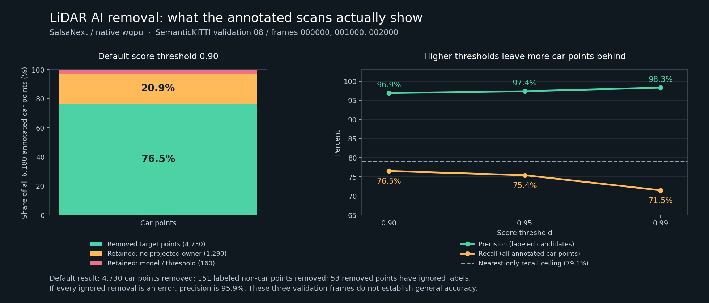

# Annotated car-removal smoke check

The current nearest-only mask removes **76.5% of annotated car points** in these
three validation scans. Precision among labeled removal candidates is **96.9%**.
It does not remove complete cars reliably: 1,290 car points cannot receive a
projected label under the conservative ownership policy, and remain untouched.
This is a diagnosis on three frames, not a general accuracy claim.

| Score threshold | Labeled-candidate precision | Full-scan car recall | False removals of labeled non-car points | Removed ignored points |
| --- | ---: | ---: | ---: | ---: |
| 0.90 (default) | 96.91% | 76.54% | 151 | 53 |
| 0.95 | 97.37% | 75.44% | 126 | 36 |
| 0.99 | 98.31% | 71.49% | 76 | 15 |

At the default threshold, 4,730 target points are removed and 1,450 are retained.
Of the retained targets, 1,290 have no projected ownership; only 160 are misses
among the model's projected owners. Projected-owner recall is 96.73%, while the
maximum full-scan recall permitted by this policy is 79.13%. Ignored labels are
excluded from confusion, following the official mapping; if every ignored
removal is an error, default precision is **95.87%**.

| Validation frame (sequence 08) | Labeled-candidate precision at 0.90 | Full-scan car recall at 0.90 |
| --- | ---: | ---: |
| 000000 | 98.75% | 71.84% |
| 001000 | 92.08% | 72.73% |
| 002000 | 99.58% | 82.31% |

The 151 labeled false removals include 87 motorcycle, 37 building, 13 road,
six fence, four sidewalk, three bicycle and one parking point. Twenty-nine
annotated target instance appearances occur across the three scans. Only one
appearance has all its points selected, and it contains just four points. These
numbers do not establish complete-object removal. Raising the score threshold
reduces both false removals and target removal; the default remains unchanged.

The next recall improvement needs a separately validated way to handle the
unclassified target returns, such as per-scan evidence before fusion. These
results do not justify spreading a front object's labels into hidden surfaces
or applying the range-image model directly to an accumulated map.

## Protocol and evidence

`protocol.json` fixes frames 000000/001000/002000, thresholds 0.90/0.95/0.99,
model digest and budgets before measured inference/metrics. Nine native GPU
results were frozen before label evaluation. Labels are never model inputs.
These are **validation sequence 08** frames; this split may have informed the
published checkpoint selection and is not an independent held-out test.

- `inputs.json`: exact six input-file hashes, original ZIP member identities,
  archive URLs/ETags, checked member CRCs and range-read receipts. Only 13,879,468
  archive bytes were transferred and 7,503,240 bytes extracted. The full 80 GB
  point archive was not downloaded. The label mirror is pinned to revision
  `a62ad7160d88cde7a6e319716dbab19151a4cdc4`; its LFS OID matches the original
  archive hash published by [CompressAI](https://interdigitalinc.github.io/CompressAI/_modules/compressai/datasets/pointcloud/semantic_kitti.html).
  The full archive SHA was not recomputed from range reads.
- `frozen-inference.json`: unchanged native binary, model, source and output
  identities for all nine runs. New-process times include setup and are not
  warmed throughput or speedup measurements.
- `audits.json`: each complete audit, per-instance retained counts and source
  pairing. `audit_sha256` hashes the embedded `report` serialized with Python
  `json.dumps(report, indent=2, allow_nan=False) + "\n"` as UTF-8.
- `summary.json`: pooled integer confusion, ratios, per-frame results and limits.
- `numeric-checks.json`: independent CPU inference for the three 0.90 results;
  every candidate mask and output record matches, with max probability error
  below 0.000016. This agreement validates computation, not semantic correctness.
- `official-accounting-check.json`: factual label mapping/split agree with the
  pinned official config. Binary car TP/FP/FN and IoU match the official NumPy
  evaluator on all nine masks. This is **not** official 19-class mIoU.

The small packet contains no scans, annotations, generated point sets, tensors
or weights. The optional audit tool and synthetic accounting tests require only
the Python standard library. [Audit usage and pairing format](../../../rust/experiments/lidar-ai/README.md#audit-removal-against-annotations).
To reproduce, obtain the corresponding original scan/annotation pairs, run the
unchanged native command at the three thresholds, then audit each frozen result.
Review data/model terms independently of the MIT software.

Primary specifications: [SemanticKITTI label format](https://semantic-kitti.org/dataset),
[official label map and split](https://github.com/PRBonn/semantic-kitti-api/blob/a9c749e8124b2243b6eef1b8bcf971a9f1173a2d/config/semantic-kitti.yaml),
[official evaluator](https://github.com/PRBonn/semantic-kitti-api/blob/a9c749e8124b2243b6eef1b8bcf971a9f1173a2d/auxiliary/np_ioueval.py),
[KITTI odometry](https://www.cvlibs.net/datasets/kitti/eval_odometry.php).
