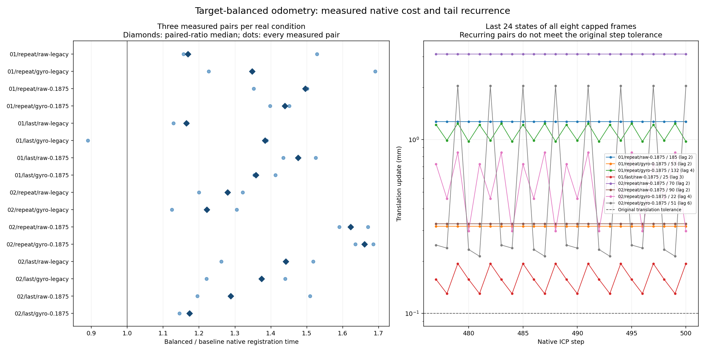

# Target-balance dynamics and native cost

All eight previously capped target-balanced registrations show repeating ordered
correspondences and multiplicities in their final 24 states. Their smallest fully
repeated lags are 2, 2, 4, 3, 2, 2, 4 and 6 iterations, in the order in
`summary.json`. Pose differences at those lags are near floating-point roundoff.
The intermediate steps remain above the original convergence tolerances. These
are observed tail recurrences, not a convergence certificate or a new stopping
policy. Every original 500-step result remains in the trajectory evaluation.

On this host, target balancing takes longer in all 16 complete real conditions.
The sum of per-condition median native registration times is about **1.398 times**
baseline. Individual condition median ratios range from **1.124 to 1.669**.
All three measured pairs per case and the separate warmup pairs are retained.
The earlier accuracy comparison remains mixed: 11 conditions improve in position
RMSE, 5 worsen. The feature remains opt-in and off by default.

## What was run

The original two real recordings provide the same 320 covered scans, with
24,000 points per scan. Raw and the previously declared gyro-compensated inputs
are prepared once using the preserved extension. The native example replays both
policies and all four sampling/compensation arms, with four requested Rayon
workers. The actual `Odometry::equations` and `step` drive every observed update.
An independent insertion/range mirror and exhaustive ordered 27-cell query
observe the selected registrations. The estimator, tolerances, limits,
prediction, map rules, weights and defaults are unchanged.

The complete native replay reproduces all original iteration counts and stopping
reasons. All **5,120 replay poses and 20,480 timing-pass poses match the original
pose bits exactly**. The executable's initial diagnostic flags compared against
its parsed decimal JSON expectations, which can differ by one rounding unit from
the original binary expectations. Both native-reported fields and independently
corrected fields are retained, along with a separate same-parser bit export.
The verifier checks both interpretations. Expected poses never initialize the
estimator, and no estimation or timing was repeated for this reconciliation.
The first failed verification and original draft are retained locally.
Traces retain every one of the
4,000 native systems and pre/post update transforms, plus full pair rows for the
predeclared last 24 states per frame. Original snapshots for all eight selected
frames are copied byte-for-byte and bind their source preparation and final pairs.

Timing uses **one warmup pair and three measured pairs per condition**, alternating
baseline/balanced order by round and condition index. Only the elapsed native
registration call is timed. This includes range filtering, sampling, ICP,
threshold learning, map insertion and pruning. The observer, residual reports
and linearization capture are disabled. Bag I/O, gyro compensation, preparation,
validation, hashing and serialization are outside the windows. The policies have
different closed-loop states and iteration counts, so this measures their native
policy costs, not the isolated overhead of target counting. It is not Python/UI
latency, complete application throughput, a one/four-worker scaling result or a
GPU timing. No other builds or tests ran during the measurement.

## Verification and retained sources

Run `python benchmarks/slam/flatwall-balance-dynamics/verify.py` from a checkout
with NumPy and SciPy. It checks the exact original cohort and closed receipts,
all 4,000 nearest-match/weight/H/b systems, every native step, final map searches,
all tail pair rows, 5,120 replay poses and 20,480 timing-pass poses, all timing
sums, counterbalanced order and derived summaries. KD search is only a broad
phase: out-of-neighborhood and tied queries fall back to exhaustive native cell
order. Final queries are also checked exhaustively. Original trajectory/reference
metrics remain in the [preceding packet](../flatwall-target-balance/README.md).

The executable, prepared inputs, logs, complete native JSON outputs and raw local
source/dependency snapshots remain in the private study. Public NPZ records are
closed conversions of those logs. Public verification checks the published
arithmetic and measured-record consistency; it does not attest wall-clock
measurements or replay raw recordings. Full preinsertion maps are provided for
the eight selected frames. Other frames' forward matching is not independently
replayed here. No reference poses are read by this audit, and no physical
calibration or covariance claim is made.

The exact executed example is retained as
[`executed-source/audit_odometry_steps.rs`](executed-source/audit_odometry_steps.rs).
After timing, clippy required the current example's preloaded reader to use
`as_chunks::<24>().0.iter()` instead of `chunks_exact(24)`. This is the only
source promotion; it occurs before timed calls and preserves complete-record
decoding. `source-promotion.json` binds both versions, and the verifier checks
that exact textual replacement. The measured executable and its source are not
replaced. All 83 local native source/configuration inputs are bound, with that
one historical source alias and normalized line endings. Dependencies and
toolchain metadata are retained; this is not a hermetic-build guarantee.

To recreate the executed native program, restore the retained example at its
`rust/crates/ca-core/examples/audit_odometry_steps.rs` path in an isolated checkout
of the recorded base and use the command in `protocol.json`. Preparation requires
the original recordings and retained closed trial; use
`scripts/prepare_flatwall_balance_dynamics.py`. The native program takes
`trace|time input.json fresh-output-dir`. The source-frozen wrapper and analysis
entry points are `scripts/run_flatwall_balance_dynamics.py` and
`scripts/analyze_flatwall_balance_dynamics.py`. Historical wrapper invocation
checks require their exact archived source inputs, including the executed
example. Earlier logs, failed clippy output and all source versions are preserved.

## Data attribution and interpretation

The inputs derive from Kenji Koide's AIST Livox/AprilTag dataset,
[Zenodo record 7641866](https://zenodo.org/records/7641866), version 2,
CC BY 4.0. This packet distributes transformed/selected numerical excerpts and
derived measurements; it does not redistribute the raw bags. Both recordings and
earlier scores were already exposed. Selection is exactly all eight previously
capped frames, not a held-out test. No solver change, early exit, damping,
fallback, parameter search, quality gate or default adoption follows from this
audit. The next candidate needs its own frozen closed-loop evaluation.
