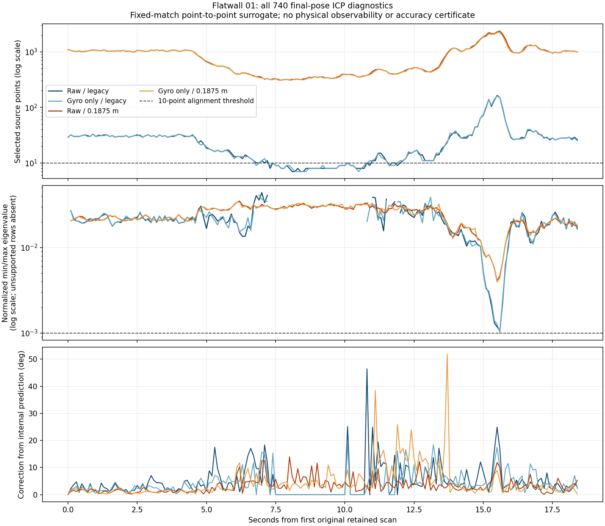

# Flatwall full-cohort constraints and prediction audit

All **4 × 185 original poses and registration reports** reproduce the frozen
controls bit for bit with diagnostic capture enabled. Independent map replay
checks all **740** final-pose snapshots. Legacy sampling loses alignment in
36 raw and 37 gyro-only scans; both include the same **26 consecutive scans
76–101** with prediction-only propagation. The first scan in each arm is a
separate empty-map anchor.

| Control | Selected points, median | Supported spectra | Insufficient points | Weak spectra below `1e-3` | Prediction correction RMS (deg) | Maximum correction (deg) |
| --- | ---: | ---: | ---: | ---: | ---: | ---: |
| Raw, legacy | 26 | 148 | 36 | 0 | 7.550407 | 46.430477 |
| Gyro only, legacy | 26 | 147 | 37 | 0 | 5.768648 | 18.436805 |
| Raw, 0.1875 m source voxel | 944 | 184 | 0 | 0 | 4.233861 | 13.995247 |
| Gyro only, 0.1875 m source voxel | 946 | 184 | 0 | 0 | 7.592079 | 51.852663 |

Prediction corrections are from the unchanged internal motion prediction to the
returned pose, across every original scan. They are not errors against a physical
reference. Counts and spectra retain all unsupported rows; no favorable segment
or arm is selected. The identical gyro-compensated point digest covers all
4,440,000 retained points.



The fine controls retain enough source points for every post-anchor registration,
yet the gyro-only fine arm makes a correction as large as 51.853 degrees.
All 663 supported fixed-match point-to-point systems remain above the existing
`1e-3` weak-direction threshold. The minimum ratios are 0.0010610 raw/legacy,
0.0010221 gyro/legacy, 0.0040588 raw/fine and 0.0039672 gyro/fine. This matrix
criterion does not explain the different conditional trajectory errors in the
[prior comparison](../flatwall-frontend-controls/README.md), and it does not
certify physical observability or alignment quality. No threshold is changed.

## What was frozen and checked

`protocol.json` and `controller-freeze.json` were written before re-reading
measurements. They pin all four prior complete estimates, the recording, the
same seven-file native runtime package, all 113 archived build/package/config
inputs and their current bytes, audit and analytic-test sources, and the
selected prior dependency inventory. CRLF/LF differences in two build files
are retained and checked separately from their original archived bytes.
The selected dependency inventory is not a hermetic environment.

The native binary SHA-256 remains
`8f8d7213ce4067f9c322ff6dba4be9ac5c7fe4f2da3413d1a0fa9a3760ea5fd2`.
There is no native rebuild or installed-extension replacement. Original scans
1–185 are retained; scan 0 remains excluded for incomplete IMU coverage. Point
times are exact integer nanoseconds and each reference is the maximum point
timestamp. Every arm uses the previous range, map, source sampling and gyro
assumptions. `capture_linearization=True` is the sole added diagnostic option.

Independent checks cover range filtering, first-point-per-floor-voxel selection,
world transforms, exhaustive 27-cell nearest-target matching with strict first
ties, per-cell capacity and pruning. Map replay uses canonical native insertion
bytes, whose transforms are checked separately, to preserve cell-boundary bits.
Selected source points, target points, matched indices and squared distances
agree bit for bit. Reconstructed normal-matrix and right-hand-side entries
match native entries exactly in this run; maximum checked transform discrepancy
is 1.421086e-14 m.

The existing internal prediction repeats the preceding body displacement:
`T_pred = T_last * inverse(T_previous) * T_last`; the first scan uses identity
and the second uses the preceding pose. Empty-map and insufficient-source cases
finish without alignment and retain the prediction, apart from the existing
rotation orthonormalization. Each such row has zero support and no spectrum.
The independently reconstructed prediction center and returned-pose correction
are checked against fixed arithmetic tolerances.

For supported rows, parameters are translation xyz then world rotation xyz
about the fixed prediction center. Residual matches and robust weights are
held fixed; the weight is `kernel**2/(kernel+distance_squared)**2`.
The spectrum is `eigvalsh(sym(D H D)/sum_w)`, where
`D=diag(1,1,1,1/r,1/r,1/r)` and `r` is weighted RMS source radius. Signed
eigenvalues remain signed, and unsupported/zero-radius rows have no spectrum.
No matrix inversion, clipping, damping, covariance estimate or estimator
feedback is introduced. A point-to-point surrogate can be full rank on a plane.

The complete selected reference and earlier five-arm results were known before
this audit was designed, so it is exploratory. This run parses no reference
poses and makes no new accuracy comparison. Archive-specific body/clock/layout
mapping and the real IMU/LiDAR calibration remain unresolved. A large prediction
correction or support loss cannot alone identify a unique physical cause.
No rejected initializer state, acceptance gate, estimator default or automatic
compensation policy is adopted.

## Evidence and verification

Data: Kenji Koide / AIST, *LiDAR Degeneration Test Dataset (Flatwall experiment)*,
v2, [DOI 10.5281/zenodo.7641866](https://zenodo.org/records/7641866), CC BY 4.0.
The source recording SHA-256 is
`4721e667166e11b948aea83b221f99ca0fec21fabdce5b292662a4b442efbab6`.

Every `frames.jsonl` row records the original scan/time, source and match counts,
support, radius, independent matrix/vector and spectrum, prediction/returned
poses, correction magnitudes and arithmetic discrepancies. The four original
trajectories and scan reports are copied verbatim and bound to their earlier
receipt. `snapshot-catalog.json` and `receipt.json` retain all 740 raw array
snapshot hashes and all 740 scalar metadata hashes; these larger snapshots and
the recording remain local. All prior protocols, failed attempts, receipts and
dependency/native snapshots remain unchanged.

```console
python benchmarks/slam/flatwall-frontend-constraints/verify.py
```

The NumPy verifier checks published bytes, source footprints, exact baseline
pose/report bindings, all 740 original scan identities, prediction arithmetic,
matrix spectra and aggregate summaries. Tests alter data and re-sign the
published file/receipt hashes to ensure semantic inconsistencies are rejected.
The public verifier does not rerun private raw snapshots or independent map
matching and supplies no physical observability, covariance or accuracy
certificate. The [controller guide](../../../docs/slam-flatwall-frontend-constraints.md)
describes the full recording replay.

Execution uses one process with independent maps, four Rayon threads for native
point compensation and one OpenBLAS thread. It makes no timing or GPU result.
The next controlled estimator question is sensitivity to the repeated-motion
prediction across all four settings, while preserving these diagnostics and
the unresolved calibration boundary.
