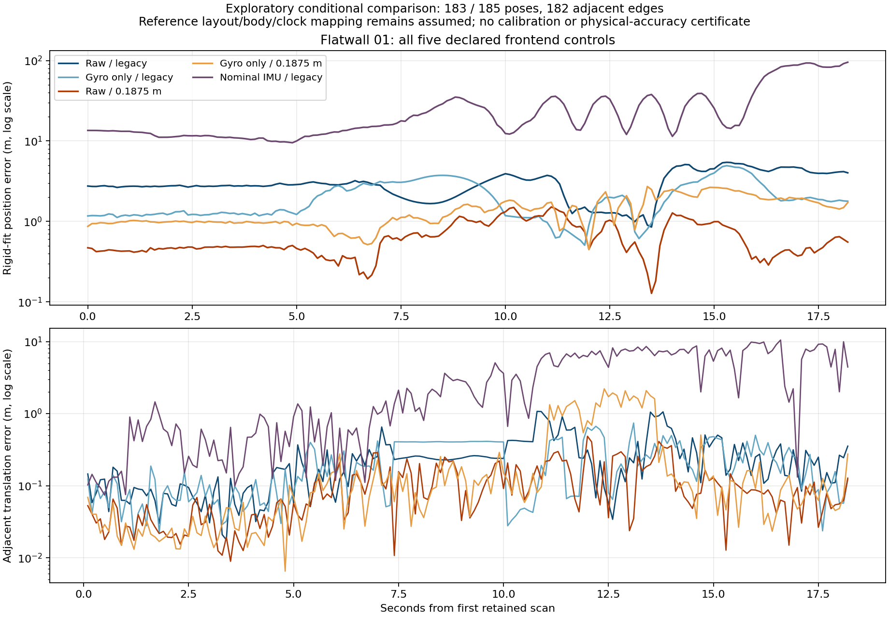

# Flatwall full-cohort frontend controls

On the same recording and conditional scoring policy, gyro compensation lowers
the legacy-sampling rigid position RMSE from 3.206 m to 2.289 m, while increasing
the fine-sampling value from 0.716 m to 1.484 m. These are exploratory arithmetic
results under unverified reference body/clock/layout assumptions. They do not
establish physical accuracy or support enabling compensation by default.

| Control | Rigid position RMSE (m) | First-pose position RMSE (m) | Adjacent translation RMSE (m) | Adjacent rotation RMSE (deg) | Estimated path (m) |
| --- | ---: | ---: | ---: | ---: | ---: |
| Raw, legacy sampling | 3.206250 | 7.250964 | 0.330940 | 9.040503 | 44.297307 |
| Gyro only, legacy sampling | 2.289095 | 3.883316 | 0.275593 | 7.331932 | 39.329220 |
| Raw, 0.1875 m source voxel | 0.715796 | 3.696776 | 0.138429 | 4.282595 | 18.251820 |
| Gyro only, 0.1875 m source voxel | 1.483599 | 2.920571 | 0.569564 | 23.656955 | 50.913118 |
| Prior nominal IMU, legacy sampling | 34.929240 | 38.057362 | 4.646373 | 31.817566 | 618.979603 |

Each control retains all **185 original estimates**. The unchanged reference
policy covers **183 poses and 182 consecutive edges**, with two tail estimates
after the reference. The conditional reference path on these edges is
4.081172 m. Even the lowest rigid-fit error accompanies an estimated path over
four times that length; this is a diagnostic baseline, not a validated solution.
Every original scan, including registration failures, remains in the packet.



The selected reference had already been fully inspected before this experiment
was designed. `reference-policy-deviation.json` retains the earlier prefix
exposure, and the [prior packet](../flatwall-trajectory/README.md) explains the
unresolved provenance. All five conditions are reported; no winner is adopted.

## Frozen estimation and scoring

`protocol.json` fixes four new controls before reading measurements for their
estimates. All four complete trajectories and per-scan diagnostics are closed
by `estimates-receipt.json` before the scoring stage, with a separate
`scoring-boundary.json`. `controller-freeze.json` pins the controller, scoring
library, analytic tests, seven native package files, 109 archived build/config
inputs plus their current bytes, and 53 selected dependency/executable files.
Two build files differ only in CRLF/LF bytes; original bytes and the comparison
are retained. This selected dependency inventory is not a hermetic environment.

The recording, native binary and nominal baseline are unchanged. The native
binary SHA-256 is
`8f8d7213ce4067f9c322ff6dba4be9ac5c7fe4f2da3413d1a0fa9a3760ea5fd2`.
All four new 64-scan prefixes reproduce earlier pose bits and registration
reports exactly. The full gyro-compensated point digest reproduces the prior
185-scan component audit. Four independent evolving ICP maps run sequentially
in one Python process; gyro point compensation uses four Rayon threads, with
`OPENBLAS_NUM_THREADS=1`. This is not a runtime or GPU experiment.

Common ICP settings are range 1.5–80 m, map voxel 1 m, 20 points per map voxel,
`deskew=False`, and diagnostics enabled. The only source sampling settings are
the pre-existing omitted legacy policy and explicit 0.1875 m voxel. No external
IMU pose prediction is supplied; the existing internal motion prediction is
unchanged. Gyro-only compensation holds body gyro between IMU samples, with
declared zero bias, identity IMU-from-LiDAR and a 50 ms maximum IMU gap. It models
rotation with a fixed IMU origin within each scan. Acceleration, translation,
and any previously rejected initialization candidate are not fed into it.

The raw cloud spans an acquisition interval. Assigning its pose to the common
maximum integer point timestamp is an explicit approximation. The gyro control
also retains uncalibrated bias/extrinsic assumptions. The prior nominal IMU arm
changes both point compensation and pose prediction; comparing it with these
controls cannot isolate a single physical cause.

| Control | Empty map | Converged | Insufficient points |
| --- | ---: | ---: | ---: |
| Raw, legacy | 1 | 148 | 36 |
| Gyro only, legacy | 1 | 147 | 37 |
| Raw, 0.1875 m | 1 | 184 | 0 |
| Gyro only, 0.1875 m | 1 | 184 | 0 |

Stopping labels do not certify alignment. In particular, the fine gyro arm has
184 convergence labels while its conditional adjacent rotation error is large.
No initializer limit, estimator default, state acceptance or calibration is changed.

Scoring inherits `inherited-scoring-protocol.json` byte for byte: exact integer
nanoseconds, fixed zero offset, unit scale, assumed TUM columns and
reference-world-from-LiDAR, at most 100 ms bracketing, linear position/SO3
interpolation, no extrapolation, one proper global rigid position fit with the
existing rank guard, first-pose SE3 diagnostics, and consecutive original edges.
There is no reference-driven time, scale, axis, extrinsic or window search.

The prior nominal metrics reproduce exactly. Installed evo independently checks
APE, RPE and no-scale Umeyama arithmetic for all five conditions; the paired
reference matrices, indices and timestamps match the previous independently
audited pairing bit for bit. This reuses that association audit and does not
claim a new independent raw-reference association. `oracle-receipt.json` reports
every maximum difference against 2e-8 m/matrix and 1e-5 degree tolerances.

Two controller setup attempts failed before any LiDAR registration because
native timestamp and point accessors were called as attributes. The original
source versions, failure logs and additive correction records are in `history/`;
all private protocols/freezes/partial outputs are preserved. The successful
version was freshly frozen at new paths before producing estimates. Neither
correction changed estimator settings or scoring policy.

## Data and verification

Data: Kenji Koide / AIST, *LiDAR Degeneration Test Dataset (Flatwall experiment)*,
v2, [Zenodo DOI 10.5281/zenodo.7641866](https://zenodo.org/records/7641866),
CC BY 4.0. The author [experiment page](https://staff.aist.go.jp/k.koide/projects/glimsupp/flatwall.html)
and [paper VI-A](https://arxiv.org/html/2407.10344v1#S6.SS1) describe the reference
construction and synchronization; the archive-specific body/clock/layout mapping
remains unverified as recorded in the inherited protocol.

```console
python benchmarks/slam/flatwall-frontend-controls/verify.py
```

The standard-library verifier checks published file hashes, frozen public source
footprints, all five conditions, shared coverage, per-scan stopping counts,
unbridged edges and recomputed summaries from every published error row. Packet
tests also reject semantic changes after a file hash is updated. It does not
rerun native estimation, decode the recording, independently parse NPZ arrays or
certify missing physical provenance. Complete new trajectories, original scan
diagnostics, source snapshots, receipts and the comparison figure are included.
The raw recording and installed dependency/native snapshots remain local.

The [controller guide](../../../docs/slam-flatwall-frontend-controls.md) describes
the two-stage interface. The next investigation should examine local registration
constraints and motion predictions at large adjacent errors, retaining the
sampling/compensation interaction and the unresolved calibration boundary.
