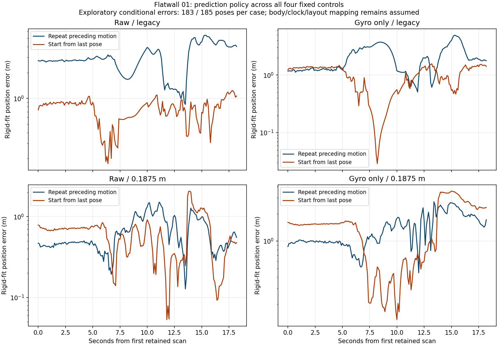

# Flatwall prediction-policy comparison

Starting ICP from the last returned pose lowers conditional rigid position RMSE
for both legacy-sampling controls. The fine gyro control has a higher position
RMSE despite a much smaller adjacent rotation error. The result supports
prediction-policy sensitivity, with different outcomes across settings and
metrics; it does not support changing the default from this recording alone.

All **eight cases** retain **185 original estimates**, with the same **183 paired
poses and 182 consecutive edges**. Two tail estimates remain after the reference.

| Sampling / compensation | Prediction | Rigid position RMSE (m) | First-pose position RMSE (m) | Adjacent translation RMSE (m) | Adjacent rotation RMSE (deg) | Estimated path (m) |
| --- | --- | ---: | ---: | ---: | ---: | ---: |
| Legacy / raw | Repeat motion | 3.206250 | 7.250964 | 0.330940 | 9.040503 | 44.297307 |
| Legacy / raw | Last pose | 0.783853 | 3.119137 | 0.166489 | 4.033874 | 20.631685 |
| Legacy / gyro only | Repeat motion | 2.289095 | 3.883316 | 0.275593 | 7.331932 | 39.329220 |
| Legacy / gyro only | Last pose | 1.075617 | 2.251054 | 0.168614 | 4.736595 | 21.200776 |
| 0.1875 m / raw | Repeat motion | 0.715796 | 3.696776 | 0.138429 | 4.282595 | 18.251820 |
| 0.1875 m / raw | Last pose | 0.714341 | 4.865943 | 0.162213 | 2.622829 | 15.885339 |
| 0.1875 m / gyro only | Repeat motion | 1.483599 | 2.920571 | 0.569564 | 23.656955 | 50.913118 |
| 0.1875 m / gyro only | Last pose | 1.778427 | 6.303637 | 0.197196 | 2.689693 | 17.917007 |

The conditional reference path on these edges is **4.081172 m**. Every estimated
path is still substantially longer. The raw fine rigid-fit RMSE changes little,
while its first-pose position and adjacent translation errors increase. These
limits matter alongside the lower legacy errors and reduced rotation spikes.



The complete selected reference, prior scores and diagnostics were inspected
before this exploratory trial. Reference body/clock/layout conventions and real
IMU/LiDAR calibration remain unverified assumptions. These numbers establish
neither calibrated physical accuracy nor GLIM equivalence.

## Controlled change and preserved inputs

The existing native API is used without a native rebuild. The first scan calls
`register(points)`; every later candidate scan calls
`register(points, relative_prediction=identity)`. Consequently, the candidate
warm start is the last returned pose. The default repeats the preceding body
displacement. It is retained from the four original frozen controls, whose
metrics reproduce exactly in this evaluation.

This changes future poses, maps, adaptive thresholds, rotation centers and
correspondences. The comparison measures the complete closed-loop policy
effect, rather than a correction on one fixed map. Point streams, range/map
settings, both source sampling policies, stopping rules, gyro compensation and
the scan/time cohort remain unchanged. No rejected initialization state or new
velocity/gravity/bias estimate is supplied.

`protocol.json` and `controller-freeze.json` pin the controller and arithmetic
sources, analytic controls, all original inputs/diagnostics, selected dependency
inventory, the same seven-file native package and 113 archived build inputs
before new measurements. The selected inventory is not a hermetic environment.
Native binary SHA-256:
`8f8d7213ce4067f9c322ff6dba4be9ac5c7fe4f2da3413d1a0fa9a3760ea5fd2`.

All four new 185-pose trajectories, scan reports, **740 native snapshots** and
their hash closure were saved before the new scoring stage. The first two
pose bits/reports match the policy-equivalent originals. Every selected
`source_sensor` point bit, registration-point count and the full gyro-compensated
4,440,000-point digest also match. Legacy source insufficiency still affects
36 raw / 37 gyro scans; the first scan of every arm is an empty-map anchor.
The same 26-scan support-loss region remains visible. Candidate unsupported
scans hold the last pose instead of repeating its preceding displacement.

Candidate fixed-match weights, normal matrices, right-hand sides, support,
radius, normalized signed spectra and prediction corrections are independently
reconstructed. Candidate map matching is **not** independently replayed. Source
coordinates match the previous independently replayed source arrays. The
insertion check undoes the previous canonical world pose and applies the new
pose within the declared tolerance; it is not fresh independent revoxelization.
All raw candidate snapshots and scalar metadata remain local and are listed in
`snapshot-catalog.json` and `estimates-receipt.json`.

All candidate supported spectra remain above the existing `1e-3` ratio. This
conditional point-to-point surrogate can be full rank on a plane; it is not a
physical quality gate, covariance estimate or explanation of the changed errors.
No default, initialization threshold, automatic compensation policy or accepted
physical state is changed. No GPU or runtime result is claimed.

## Reference and independent arithmetic

The prior reference policy is unchanged: declared TUM syntax and
reference-world-from-LiDAR, fixed zero offset, identity body transform, unit
scale, exact integer nanoseconds, at most 100 ms bracketing, linear position and
SO3 interpolation, no extrapolation, one proper rigid position fit with its rank
guard, first-pose SE3 diagnostics and original consecutive edges. There is no
reference-driven clock/scale/axis/extrinsic/window/threshold selection.

All eight paired reference matrices, integer times and original indices match
the previous independently audited pairing bit for bit. Frozen installed evo
independently checks APE, RPE and no-scale Umeyama arithmetic for every case,
with discrepancies recorded against 2e-8 m/matrix and 1e-5 degree tolerances.
This reuses the earlier association audit; it supplies no new independent
raw-reference association or missing physical provenance.

`paired-reference.npz` publishes those **183 derived interpolated reference
matrices**, times and indices. `derived-reference.json` pins the pre-existing
source pairing and documents the transformation. These are derived values under
the declared assumptions, not an author-issued replacement reference file.

Data and derived reference: Kenji Koide / AIST, *LiDAR Degeneration Test Dataset
(Flatwall experiment)*, v2, [DOI 10.5281/zenodo.7641866](https://zenodo.org/records/7641866),
CC BY 4.0. The [earlier provenance record](../flatwall-trajectory/README.md)
retains the initial reference-inspection deviation and unresolved mapping.

## Verification and repository dependencies

```console
python benchmarks/slam/flatwall-prediction-policy/verify.py
```

The NumPy verifier recomputes all eight APE/RPE error sequences and summaries
from published trajectories and the derived paired reference. It also checks
coverage, unbridged edges, baseline bindings, source footprints, prediction
arithmetic and diagnostic spectra. Tests alter scores/error rows, update their
published output/receipt hashes, and require semantic rejection.

The manifest hashes **26 existing files** in the two earlier frontend packets,
the reference policy/deviation record and the prior diagnostic verifier. Keep
those repository paths when running this packet; it is not a standalone folder.
This reuses the immutable original trajectories/reports/diagnostics instead of
copying them again. New candidate artifacts, evaluation rows, source snapshots,
receipts and the figure are in this directory.

Public verification does not decode the recording, rerun private native snapshots
or independently establish raw-reference association or physical accuracy. The
[controller guide](../../../docs/slam-flatwall-prediction-policy.md) describes
the full two-stage run and its fresh-output requirement.
