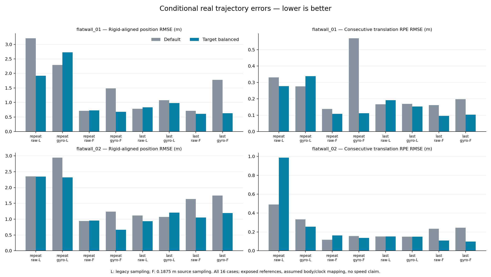

# Opt-in target-balanced LiDAR odometry

Target balancing improves conditional rigid-aligned position RMSE in **11 of 16** frozen real cases and worsens it in **5**. All four fine-sampling + gyro cases improve position RMSE by about **31–64%**. This is a mixed closed-loop result, so the new `target_balance` option remains **false by default**. No universal winner, physical calibration, GLIM equivalence or runtime/GPU speedup is established.

The study closes all 2,560 candidate frames and all 2,560 same-build default replays before reference scoring. Every default pose and pre-existing diagnostic array matches the old snapshots bit for bit. The candidate changes the actual iterative weights, poses, later map contents and learned thresholds; this is not just a final-pose counterfactual diagnostic.



## All conditions

Position errors use the inherited proper rigid position fit, without scale fitting. RPE uses only consecutive original scan IDs and never bridges coverage gaps. All entries are RMSE in metres; the percentage is position RMSE change, negative meaning a reduction.

| Recording | Prediction | Input / sampling | Default → balanced position | Position change | Default → balanced translation RPE |
|---|---|---|---:|---:|---:|
| 01 | repeat-motion | raw-legacy | 3.2062 → 1.9183 | -40.2% | 0.3309 → 0.2769 |
| 01 | repeat-motion | gyro-legacy | 2.2891 → 2.7276 | +19.2% | 0.2756 → 0.3379 |
| 01 | repeat-motion | raw-0.1875 | 0.7158 → 0.7288 | +1.8% | 0.1384 → 0.1083 |
| 01 | repeat-motion | gyro-0.1875 | 1.4836 → 0.6821 | -54.0% | 0.5696 → 0.1118 |
| 01 | last-pose | raw-legacy | 0.7839 → 0.8351 | +6.5% | 0.1665 → 0.1920 |
| 01 | last-pose | gyro-legacy | 1.0756 → 0.9812 | -8.8% | 0.1686 → 0.1535 |
| 01 | last-pose | raw-0.1875 | 0.7143 → 0.6090 | -14.7% | 0.1622 → 0.0962 |
| 01 | last-pose | gyro-0.1875 | 1.7784 → 0.6325 | -64.4% | 0.1972 → 0.1030 |
| 02 | repeat-motion | raw-legacy | 2.3498 → 2.3463 | -0.1% | 0.4912 → 0.9872 |
| 02 | repeat-motion | gyro-legacy | 2.9447 → 2.3177 | -21.3% | 0.3341 → 0.2561 |
| 02 | repeat-motion | raw-0.1875 | 0.9438 → 0.9570 | +1.4% | 0.1184 → 0.1620 |
| 02 | repeat-motion | gyro-0.1875 | 1.2413 → 0.6654 | -46.4% | 0.1563 → 0.1375 |
| 02 | last-pose | raw-legacy | 1.1160 → 0.9341 | -16.3% | 0.1514 → 0.1510 |
| 02 | last-pose | gyro-legacy | 1.0736 → 1.2075 | +12.5% | 0.1503 → 0.1503 |
| 02 | last-pose | raw-0.1875 | 1.6367 → 1.0510 | -35.8% | 0.2335 → 0.1092 |
| 02 | last-pose | gyro-0.1875 | 1.7449 → 1.1948 | -31.5% | 0.2449 → 0.0984 |

The four fine/gyro position improvements occur under both prediction policies and both recordings. The raw/fine repeat-motion cases worsen position on both recordings, and sparse cases are mixed. In particular, 02/repeat/raw-legacy has a tiny position reduction while its translation RPE approximately doubles. All metrics, including first-pose position/rotation and rotation RPE, remain in the packet; selecting one improved aggregate does not establish better motion overall.

No hyperparameter sweep or reference-driven clock, body-frame, extrinsic, scale, scan-window or threshold correction was performed. Both complete recording scores were already exposed before this trial, and the rule was chosen from the previous correspondence-reuse diagnostic. This is exploratory rather than blind or held-out evaluation.

## Native rule and API

At **each ICP iteration**, use the existing source selection, native 27-cell nearest search and learned correspondence threshold. Count the accepted matches selecting exactly the same target coordinate, with signed zero coordinates equal. Divide each original robust weight by that count:

```
robust_i = kernel**2 / (kernel + squared_distance_i)**2
effective_i = robust_i / count(target_i)
```

Keep every threshold-accepted pair. Matching and weighted H/b accumulation use the existing Rayon CPU pool; counting is serial and no speed improvement is claimed. Repeated identical pairs no longer increase their target's aggregate influence. Different source samples sharing a target still contribute their own residual and Jacobian. This is a density-balancing heuristic, not an outlier label or a calibrated noise model.

The normal-equation order stays translation xyz then world-axis left rotation xyz around the frozen prediction center c: `J=[I,-[q-c]x]`, `H=J^T W J`, `b=-J^T W(q-p)`. Solver pivots, failure states, iteration limits/tolerances, motion prediction, threshold learning and insertion rules are unchanged. New poses nevertheless change subsequent map geometry. There is no added damping, fallback, spectral gate or initializer-state adoption.

With a core build containing this API:

```python
from cloudanalyzer_core import LidarOdometry

odometry = LidarOdometry(
    registration_voxel=0.1875,
    target_balance=True,
    capture_linearization=True,
)
```

The property is read-only in Python. Rust callers can use `set_target_balance(true)` before starting a registration; pending registrations retain their own policy. Use `Odometry::equations` for the policy-aware Rust step path. No browser setting is added. Final-pose diagnostics expose `robust_weights`, `target_multiplicity`, `target_balance` and effective `weights`; the matrix represents the effective-weight surrogate at the returned pose, not the last attempted solve or a calibrated information matrix.

## Verification and limits

From the repository root:

```
python benchmarks/slam/flatwall-target-balance/verify.py
python -m pytest cloudanalyzer/tests/test_flatwall_target_balance_packet.py -q
```

The independent verifier imports no candidate estimator or scoring implementation. It reuses the already published independent exact-fraction/quaternion reference oracle, checks both verbatim author reference members, all exact-time associations and all 16 candidate metric sets, and rechecks default metrics against the same references. It also verifies 2,560 default pose-bit replays against old public frames, every candidate frame spectrum/summary, and the raw arithmetic on 48 predetermined native snapshots with full pre-insertion maps. Samples are cohort ordinals 1, floor(N/2), N-1 without replacing empty samples.

The private controller independently checks source/insertion selection and transforms, every final-pose target multiplicity, raw/effective weight and H/b on all candidate frames. It replays candidate map insertion and byte membership of captured targets, not the complete native nearest-search decisions. The public raw samples recompute weights/H/b and map membership; the public verifier does not rerun raw-bag processing, every private raw system or the complete closed-loop estimator. All 2,560 private NPZ/JSON pairs remain inventoried by hash, with only the predetermined samples distributed. Full receipts consequently name files absent from the public packet.

For 01, 183 of 185 estimates are reference-paired with 182 consecutive edges. For 02, 114 of 135 estimates are paired with 111 consecutive edges: 20 reference-gap exclusions and one tail exclusion remain. Association uses exact integer nanoseconds, no extrapolation and a maximum enclosing bracket of 100 ms. Reference translation uses linear interpolation and orientation uses the shortest quaternion arc. Fits use a proper rotation, unit scale and the inherited 1e-10 rank guard. Reference body axes/clock and the author-configured identity IMU transform remain assumptions, not physical calibration certificates.

Native controls cover exact coordinate grouping, signed zero, threshold support, repeated-pair influence across parallel chunks, pending-policy retention, analytic rigid motion, passive capture, failure states and owned arrays. All 100 local odometry Python tests and 22 related Rust tests passed before real estimation. Candidate and default snapshots preserve every original input identity and clock. Packet tests also resign altered hashes and still reject semantic changes.

The first scoring invocation failed before reading references because its estimates path was relative. Its original log and empty output directory remain preserved. The separately frozen `run_flatwall_target_balance.py` entry normalizes filesystem paths before dispatch to the unchanged frozen controller; the successful score uses a fresh output directory. `scoring-invocation-freeze.json` records the wrapper and failed-log identities. The estimator and scoring formulas were not changed.

## Native and artifact provenance

The new binary is a separate private package, built offline from 115 inventoried source/config/package/test inputs. `native-build-inputs.json` records raw archived identities and normalized LF source identities; the public verifier checks the latter across platforms. The binary hash is in `native-artifact.json` and the frozen protocol. It is not redistributed in this packet, and no installed extension was replaced.

All earlier artifacts, protocols, controllers, receipts, source/dependency/native snapshots and failures remain preserved. Prior live native source inputs have their own exact-byte archive and digest ledger while the development checkout receives the declared changes. Five original live files were recovered from the base Git blobs using the exact prior-digest-matching checkout newline representation. Old archived source/native files were never replaced. Selected dependency/toolchain identities are recorded; this is not a claim of a hermetic rebuild.

Derived from `flatwall_01.bag` and `flatwall_02.bag`, Kenji Koide (AIST), [Zenodo record 7641866, version 2](https://zenodo.org/records/7641866), licensed [CC BY 4.0](https://creativecommons.org/licenses/by/4.0/). Trajectories, snapshots and diagnostics are derived works. The selected reference members `gt/flatwall_01.txt` and `gt/flatwall_02.txt` are retained verbatim with member hashes and attribution. Raw recordings are not redistributed here.
