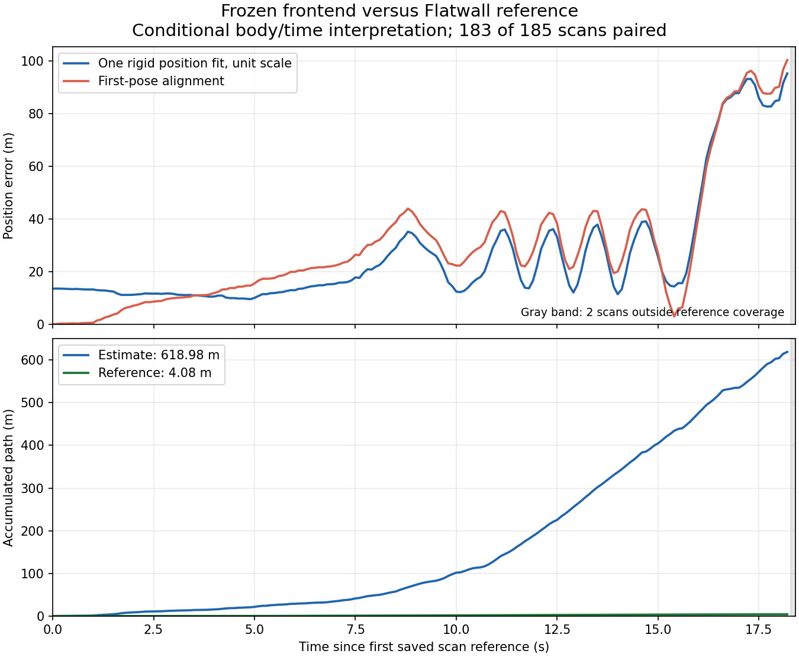

# Flatwall frozen-trajectory diagnostic

The frozen nominal-motion frontend shows a large mismatch under the declared
reference interpretation. This exploratory evaluation keeps the original
uncalibrated estimates and reports the complete coverage accounting.

| Covered-subset quantity | Result |
| --- | ---: |
| Original saved estimates | 185 |
| Interpolated reference pairs | 183 |
| Tail estimates after reference coverage | 2 |
| Consecutive original-scan edges | 182 |
| Position APE RMSE, one rigid position fit | 34.929240 m |
| Position APE RMSE, first-pose alignment | 38.057362 m |
| Consecutive SE3 translation RPE RMSE | 4.646373 m |
| Consecutive SE3 rotation RPE RMSE | 31.817566 degrees |
| Accumulated estimated/reference path on those edges | 618.979603 / 4.081172 m |

All errors are conditional on the layout, body and clock assumptions below.
These statistics cover 183 poses; full-cohort accuracy is unavailable for the
two tail poses. The original first recording scan was already rejected for
uncovered IMU time before estimation; original scan indices 1 through 185
remain present in `samples.json`. `edges.json` retains every eligible adjacent
edge and its actual elapsed time. RPE here is per consecutive scan interval.



## Provenance and declared interpretation

The [author's dataset page](https://staff.aist.go.jp/k.koide/projects/glimsupp/flatwall.html)
describes a LiDAR reference trajectory obtained from camera observations of
wall tags. [GLIM paper VI-A](https://arxiv.org/html/2407.10344v1#S6.SS1)
describes batch tag/IMU camera estimation, synchronization with the host using
PTP, and calibrated LiDAR-camera alignment. The raw input is Kenji Koide's
[Flatwall dataset v2](https://zenodo.org/records/7641866), DOI
10.5281/zenodo.7641866, CC BY 4.0.

The located primary documentation does not explicitly establish the archive's
column order, pose direction, body axes or numerical clock/extrinsic mapping.
This study **assumes** `timestamp tx ty tz qx qy qz qw`, Unix seconds, metres,
reference-world-from-LiDAR, zero clock offset and identity body transform.
The [TUM format definition](https://cvg.cit.tum.de/data/datasets/rgbd-dataset/file_formats#ground-truth_trajectories)
defines that syntax for TUM; it does not establish the Flatwall convention.
No clock, scale, axis, extrinsic or window is selected by reference error.

Before this policy was frozen, an earlier inventory inspected 16 KiB prefixes
of all eight reference members and retained eight nonempty lines per member.
`reference-policy-deviation.json` preserves that boundary violation. Subsequent
evaluation is explicitly exploratory and reference-inspected. The complete
selected member was parsed after `protocol.json` and evaluator/dependency
source identities were frozen. Only `gt/flatwall_01.txt` was parsed in this study.

## Arithmetic and controls

Decimal reference seconds become exact int64 nanoseconds. An estimate must
have an exact reference row or a surrounding interval no longer than 100 ms;
there is no extrapolation. Translation is linear and orientation uses shortest
arc SO3 interpolation. Quaternion norms must be within `1e-5` of one;
normalization within that bound is explicit, with original discrepancies
reported. Invalid rows and improper poses fail explicitly.

The primary position fit uses one proper rotation and translation, unit scale,
and every covered position. Position/cross-covariance singular values and ranks
are exposed. A rank below two suppresses that fit instead of selecting an
arbitrary rotation; first-pose diagnostics remain available. RPE and path
length never bridge an excluded original scan.

32 analytic controls preceded the first complete reference read. Installed evo
1.37.1 independently parsed the same numeric tokens, interpolated quaternions,
performed no-scale Umeyama alignment and evaluated APE/RPE. Its decimal-time
association uses a separate bisect path. Maximum position-error disagreement
was below `1e-13` m; these checks validate arithmetic under the same assumptions.
See [evo's metric/alignment documentation](https://github.com/MichaelGrupp/evo/wiki/Metrics#alignment).

After inspecting the complete reference, a parser review found that Decimal's
default arithmetic context could silently round extremely long subnanosecond
tokens. The current evaluator converts decimal digits without that arithmetic.
This correction passed 35 analytic controls and reproduced all five original
JSON reports byte for byte and all nine paired/error arrays bit for bit. The
initial source snapshots, reports and receipts are preserved; the explicitly
post-inspection `strict-time-*` follow-up records the correction and current
source identities. No numerical evaluation threshold changed.

## Scope and verification

The input frontend uses declared zero initial velocity/bias, nominal gravity,
an acceleration scale of 9.80665, identity IMU-from-LiDAR and a fixed nominal
IMU trajectory. It performs no calibrated initialization or coupled state
update. The large mismatch is preserved as a failed diagnostic baseline.
Application defaults and native estimation code are unchanged. Missing
archive-specific body/clock provenance prevents an established physical SLAM
accuracy claim or comparison to published GLIM scores. This study measures no
runtime or GPU speedup.

```console
python benchmarks/slam/flatwall-trajectory/verify.py
```

The verifier checks bytes, public evaluator source footprints, coverage, edge
identity and summary arithmetic. `controller-summary.json` is explicitly a
projection of the private environment freeze. `oracle-controller.py` archives
the original controller and its historical private input layout. Original
report/receipt bytes are copied verbatim; raw bag/reference archives and private
trajectory/error NPZ files are omitted. Their hashes remain in the receipts.
The verifier does not independently rerun those arrays or certify missing
physical provenance. The reusable evaluator and its input-layout requirements
are described in [the evaluation notes](../../../docs/slam-flatwall-trajectory.md).
