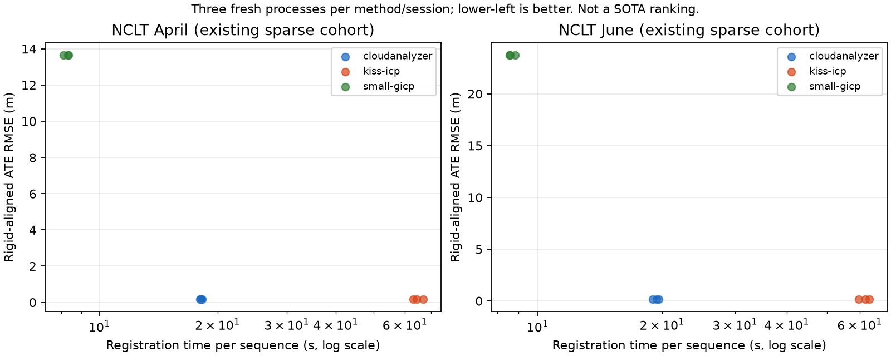

# NCLT LiDAR-only baseline comparison

This packet measures CloudAnalyzer's native LiDAR odometry against KISS-ICP
1.2.3 and a small_gicp 1.0.0 scan-to-map VGICP adapter. It is a baseline
measurement on an existing development cohort, not a SOTA ranking or held-out
evaluation. No parameters were selected using these new scores.

## Results

All 18 runs completed with full pose coverage. Values below are medians of
three runs; accuracy was identical across the three repetitions for each arm.
Translation RPE is the RMS consecutive-pose error, not KITTI segment drift.

| Session | Method | ATE RMS (m) | Translation RPE RMS (m) | Rotation RPE RMS (deg) | Registration (s) | Peak process RSS (MiB) |
| --- | --- | ---: | ---: | ---: | ---: | ---: |
| April | CloudAnalyzer | 0.16545 | 0.16794 | 2.03809 | 18.166 | 133.1 |
| April | KISS-ICP 1.2.3 | 0.16765 | 0.17272 | 2.03584 | 64.246 | 152.5 |
| April | small_gicp VGICP | 13.66544 | 0.98129 | 4.79225 | 8.330 | 146.1 |
| June | CloudAnalyzer | 0.15414 | 0.14110 | 1.73089 | 19.404 | 126.8 |
| June | KISS-ICP 1.2.3 | 0.15486 | 0.14201 | 1.73207 | 61.860 | 145.3 |
| June | small_gicp VGICP | 23.76632 | 1.06548 | 5.86300 | 8.602 | 138.5 |

Registration times ranged from 18.020–18.274 / 18.978–19.605 seconds for
CloudAnalyzer, 63.061–66.705 / 59.668–63.279 for KISS-ICP, and
8.100–8.359 / 8.564–8.840 for small_gicp (April / June).
Full-precision values, pipeline/subprocess times, p95 frame latency and all
observed ranges are in `summary.json`; individual runs are in `results.json`.



CloudAnalyzer's measured registration time was 3.54x / 3.19x lower than this
KISS-ICP operating point, with nearly equal trajectory errors. The millimetre
ATE differences do not establish a meaningful accuracy advantage, especially
given reference uncertainty. The VGICP adapter is fastest but loses trajectory
accuracy badly here; its synthetic-suite success did not transfer to these
sparse real scans. This result does not establish the best achievable small_gicp
configuration, compare complete SLAM/LIO systems, or justify a SOTA claim.

## Next experiment and decision

Keep the current default unchanged. First test the fixed CloudAnalyzer/KISS-ICP
settings on previously unexamined, longer, full-rate sequences with reference
coverage, retaining startup, difficult intervals and failed runs. Report both
registration and whole-process time on the same machine. Specify the sequences
and scoring rules before execution; do not tune against their reference poses.

Treat small_gicp's failure as a robustness issue to diagnose separately:
inspect correspondence support, convergence and pose increments using a
development split before selecting any new operating point. Changes require a
new frozen protocol and a distinct held-out evaluation. This packet records a
baseline only; it contains no algorithm change or production adoption.

## Protocol

- April: 236 poses over 188.41 seconds and approximately 250 m.
- June: 238 poses over 189.60 seconds and approximately 253 m.
- All methods receive the same bundled NCLT scans, cropped to 1.5–80 m.
  These are synchronized/motion-compensated, spatially thinned demo scans,
  approximately 1.25 Hz. They are not full-rate raw NCLT sequences.
- No IMU, deskew, loop closure, ground-truth initialization or map export.
  The historical `velodyne` frame label is interpreted as body-z-up according
  to `scripts/nclt_body_frames.py` and the existing NCLT frontend audit.
- Three fresh processes per method/session, cyclic method order, one thread
  requested for each compute library. The shared VM is not a controlled bare
  metal performance lab. See `environment.json` for CPU/quota details.
- Map voxel size is 1 m. CloudAnalyzer and KISS-ICP use 20 points/voxel and
  their own local-map policies. VGICP uses 0.5 m preprocessing, 5 m maximum
  correspondence distance and 30 iterations; its map retains all scans.
  Native and KISS-ICP use their existing convergence policies (up to 500
  iterations). This compares explicit operating points, not identical solvers.

`registration_seconds` includes every scan's preprocessing, registration and
map update, including startup. `pipeline_seconds` additionally includes scan
decoding/cropping and estimator setup; package imports after decoding can also
contribute. `subprocess_seconds` includes process startup and artifact writing.
The process high-water RSS includes Python, imports, all decoded scans and maps;
it is not incremental algorithm memory or system-wide memory use.

The experiment runner finishes all 18 estimator subprocesses before reading
reference data for scoring. Preparation checked timestamp coverage beforehand;
no parameter was changed based on an estimated trajectory's reference error. Scoring
uses the archived original NCLT body-pose CSV rows, with body-z-up conversion,
linear position/SO(3) interpolation and a maximum 50 ms reference bracket.
ATE uses one global rigid position alignment per session, without scale.
RPE uses consecutive full SE3 increments at the sparse scan intervals. NCLT
reference poses combine SLAM/RTK and odometry interpolation; they are not
statistically independent sensor truth. No reference-map quality is measured.

## Reproduce and audit

Use a Linux Python 3.12 environment with the repository's native core and
recording readers installed, plus the versions in `requirements.txt`:

```sh
pip install -r benchmarks/slam/nclt-odometry-baselines/requirements.txt
OMP_NUM_THREADS=1 OPENBLAS_NUM_THREADS=1 MKL_NUM_THREADS=1 RAYON_NUM_THREADS=1 \
  PYTHONPATH=cloudanalyzer python scripts/compare_nclt_odometry.py experiment \
  --out /tmp/nclt-odometry-new
python benchmarks/slam/nclt-odometry-baselines/verify.py
python benchmarks/slam/nclt-odometry-baselines/summarize.py
```

The experiment requires a new output directory. Each run retains every pose,
timestamp and per-frame duration in `poses.npz`, plus settings, input identity
and runtime metadata in `run.json`. `results.json` retains all repetitions,
including unfavorable scores. Native binary identity is recorded; the packet
does not claim that a differently built binary will reproduce its timings.

The verifier checks identities and recomputes every trajectory score using the
existing independent NCLT verifier's matrix-based SE3 math. It verifies saved
timing aggregates, not the accuracy of clock measurements, estimator execution,
or physical ground truth. The summary shows medians and observed min/max over
three runs, not confidence intervals.

Source: [University of Michigan NCLT](https://robots.engin.umich.edu/nclt/),
Carlevaris-Bianco, Ushani and Eustice, IJRR 2016. NCLT-derived contents retain
ODbL 1.0 / DBCL 1.0 terms. Software retains the repository software license.
