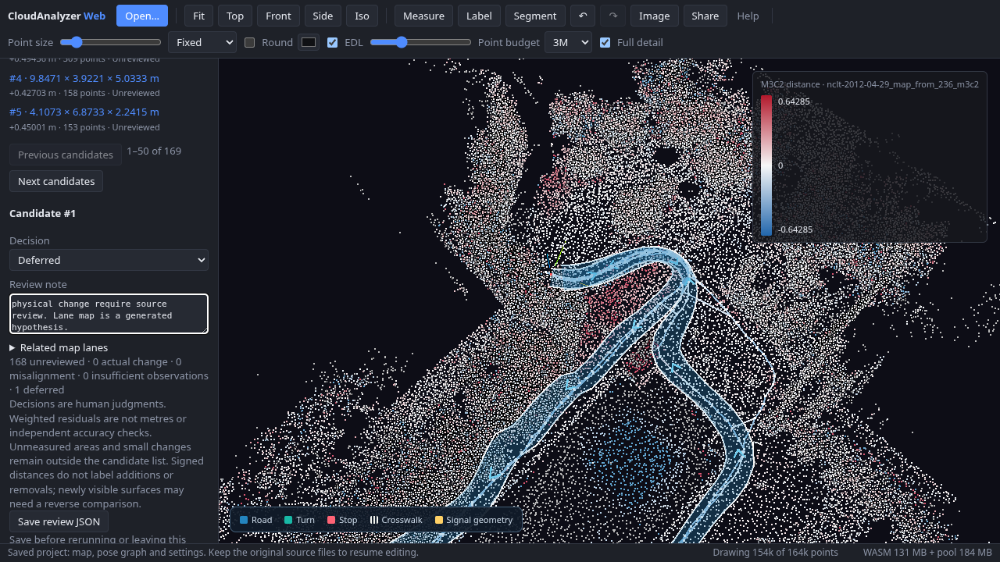
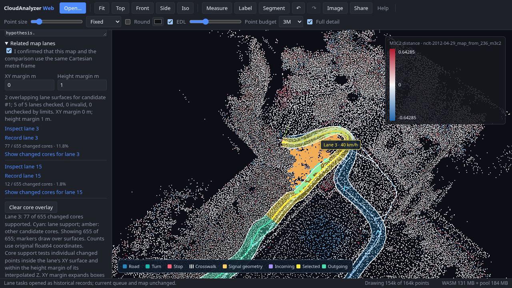

# NCLT survey comparison → Lanelet2 review → follow-up task

The real-data workflow completes. Its largest actionable limitation is that
**bounding-box overlap is too broad to establish point-supported lane links**:
24 candidate/lane pairs intersect, but 11 have no individual changed core
projecting into that drafted lane within the configured 1 m height margin.
This is a geometric diagnostic, **not** a physical-change false-positive rate.
The generated lane draft also has source-support failures. Keep decisions pending.

## Inputs and scope

Both inputs are bundled, 190-second excerpts of University of Michigan NCLT:
2012-04-29 and 2012-06-15, originally thinned to 0.8 m. See the
[sample attribution](../../../web/public/samples/ATTRIBUTION.md) and source
hashes in [verification.json](verification.json).

No independently surveyed, matching Lanelet2 map or labeled natural-change set
was available. The map is generated from the April cloud and the first 199
corrected poses of the joined graph, so it shares the comparison's local metre
frame by construction. One forward lane, no backward lane, 3.5 m nominal width,
50 m pieces, right-side traffic and 40 km/h are **configured, unverified layout
assumptions**. They do not establish actual lane counts, lane boundaries or rules.
The native writer reports a Local projector and no georeference.

This checks workflow, byte preservation, measurement consistency and geometric
proxies. It cannot determine independent map accuracy, natural-change precision/
recall, human search time or usability improvement.

## Observed results

| Check | Result |
| --- | --- |
| Corrected keyframes | April 199; June 195 |
| Cross-session loop constraints | 40 |
| Weighted residual √χ² | RMS 0.4863; maximum 1.2352; **not metres** |
| M3C2 core points | 163,699 |
| Measured / unmeasured | 145,113 / 18,586; 11.35% unmeasured |
| Changed-object candidates | 169; minimum 0.3 m, 1 m clustering, 8 cores |
| Draft | 5 lane pieces over approximately 243.1 m |
| Source quality | 3 of 5 lanes require source review |
| Candidate boxes intersecting draft lanes | 18 candidates, 24 candidate/lane pairs |
| Individual-core support | 13 pairs have at least one supported core; 11 have zero |
| Selected candidate #1 → lane 3 | 77 of 655 changed cores project into this lane within 1 m Z |
| Follow-up | One explicitly Deferred task, exported and opened as history |
| Native map/graph after review and task saving | Exact saved JSON unchanged |
| Identical-recording control | Same April recording twice: **0 candidates** |

The selected candidate has mean signed M3C2 distance +0.4731 m. This does not
identify an addition/removal, establish the cause, or prove a map update is
required. Its box spans roughly 11.2 × 21.1 × 3.6 m and can bridge empty space.
The selected candidate and its follow-up are Deferred; the other 168
candidates remain Unreviewed. No physical-change cause is confirmed.



Screenshot: University of Michigan NCLT, derived local point/map display;
ODbL / DBCL attribution below. This is evidence from the browser workflow, not a
new presentation design or an independent ground-truth map.

The first successful automated run took 67.951 s; the second, including a PLY
export and source audit, took 60.961 s. Their complete comparison identities and
169-candidate counts agree. Cache, machine load and extra steps differ; these
are observations, not performance improvements or manual-review timings.
See [repeatability.json](repeatability.json), [control.json](control.json) and
[runtime.json](runtime.json). The identical-recording control took 58.964 s,
with 167,173 cores, 156,598 measured and none forming a changed-object candidate.
It checks identical-input self-consistency, not general real-world false alarms.

## Independent geometric check

[verify.py](verify.py), using NumPy rather than the browser's Three.js box/triangle
routine, checks both MCAP hashes and the exported PLY hash. It checks all 169
objects' point counts, centroids, bounds and signed means against their actual
`change_object` core labels. The PLY contains original double XYZ and float
M3C2 attributes; no display-coordinate shift or point thinning is substituted.

It reconstructs lane strips from reopened IR boundaries using XY-station
resampling. For each box-linked pair it tests each changed core's XY barycentric
inclusion and distance in Z from the locally interpolated surface. This proxy
uses XY margin 0 and height margin 1 m, matching this run's configuration.
[point-support.json](point-support.json) records every pair and its supporting
core count. Its 11 zero-support pairs must not be labeled as physical false
positives: sparse observations, elevated objects, occlusion or a wrong draft
can all affect this proxy. Conversely, nonzero support does not prove a change.

The source audit has endpoint/height support holds on lanes 3, 6 and 9. This
uses the existing quantile protocol (three returns within 0.75 m and height
agreement within 0.3 m), not an independent survey accuracy measurement.

## Reproduce

Build the current WASM and production app, then:

```sh
cd web
CLOUDANALYZER_REAL_DATA=1 PW_CHROMIUM_EXECUTABLE_PATH=/usr/bin/chromium \
  npx playwright test e2e/survey-change-real-data.spec.ts --workers=1
```

The opt-in spec runs April/June through odometry, IMU gravity, merge, loops and
M3C2. It drafts from the April inputs, audits source support, writes and reloads
Lanelet2, enumerates all box/lane links, selects a real candidate, compares both
passes, and saves/reopens a Deferred follow-up. It also runs the identical-April
control. Without the environment flag, both large-data tests skip.

The Playwright result folders contain original-coordinate M3C2 PLY, initial/final
review JSON, generated/reopened map IR, Lanelet2 OSM, projector YAML, corrected
April KITTI poses, all associations, the task JSON and screenshots. The large
artifacts stay outside git; this run is retained under
`/workspace/work/nclt-survey-validation/{main,control}` in the execution workspace.
From the repository root, with NumPy installed:

```sh
python benchmarks/vector-map/nclt-survey-change-review/test_verify.py
python benchmarks/vector-map/nclt-survey-change-review/verify.py \
  --artifacts /path/to/the/main-result-folder \
  --out /tmp/nclt-point-support.json
```

Only the smaller result packet and attributed screenshots are kept in this
repository packet.
Source hashes, protocol settings and source/output snapshots are records of this
run, not claims that future machines must reproduce wall times or JSON timestamps.

## Bug found and fixed

The original identical-recording attempt selected another bag after the graph's
pose table appeared, while automatic IMU gravity correction was still running.
**Join files** remained enabled, unlike **Join folder**; `merge()` returned early
and the picked file was lost. Both controls now share the graph busy-state guard.
A regular browser regression holds an optimization request pending, checks both
buttons disabled, then releases it and checks both enabled. The real control
waits for the button to become enabled after each IMU stage rather than waiting
for a transient Joined status that gravity correction can immediately replace.
This is a UI guard fix; no change threshold, source-quality threshold or
registration algorithm was relaxed to make the experiments pass.

## Individual-core inspection follow-up

Related lanes now show original-coordinate changed-core counts alongside the
existing box links. **Show changed cores** uses cyan for a selected lane's
supported cores and amber for the candidate's remaining cores. Zero-support
links remain visible and recordable; unavailable evidence is explicit rather
than displayed as zero. The overlay is a transient inspection aid and does not
edit saved map, graph or survey/task data.

The opt-in workflow also compares all 24 displayed pairs against the independent
[point-support.json](point-support.json) baseline. The browser evidence and its
comparison/map identities are recorded separately in `browser-core-support.json`;
this follow-up does not replace the original baseline or timing measurements.
All 24 pairs match exactly, including lane 3's **77 / 655** and all **11 zero**
links. The complete comparison identity matches the earlier baseline.



Screenshot: University of Michigan NCLT, derived local point/map display;
ODbL / DBCL attribution below. Markers draw over surfaces for inspection.

## Saved core evidence follow-up

New lane tasks save the original-coordinate core result and `xy-lane-z-v1`
settings in an additive v1 `coreSupport` field. Recording re-reads the candidate
and selected lane; current queue and historical file views display the saved
count. A recorded zero remains zero, unavailable results carry a null count and
reason, and older files display **Core support not recorded**. Counts remain
attached to their original task when decisions or source maps change.

Regular browser checks cover complete and zero counts, historical reopen,
legacy files, explicit unavailable evidence, and aborting a record when the map
is replaced during core collection. Native map and graph saves remain unchanged.
The real-data workflow also checks a saved and reopened **77 / 655** snapshot:
[saved-core-evidence.json](saved-core-evidence.json). Its map/comparison identities
match the original baseline; the full follow-up artifacts are retained under
`/workspace/work/nclt-core-persistence-run`. Existing baseline/timing files are
preserved. This follow-up passed all 24 browser/independent count comparisons.

## Missing measurements

Treat zero-support links as inspection cues; do not silently discard them before
independent labels establish how that affects missed changes.

Manual comparison remains unmeasured. [manual-review.csv](manual-review.csv) is
an empty score sheet, not a result. Use matched segments, counterbalance manual
point-cloud search versus the candidate workflow, and record actual start/end
times, decisions and unresolved registration/observation cases. An independent
reviewer or field reference must adjudicate actual changes before filling true/
false positives or misses. The 68-second automated run is not a human baseline.

Data: N. Carlevaris-Bianco, A. K. Ushani and R. M. Eustice, University of Michigan
North Campus Long-Term dataset, IJRR 2016. Underlying and derived database data
remain subject to [ODbL](https://opendatacommons.org/licenses/odbl/1-0/) and
[Database Contents License](https://opendatacommons.org/licenses/dbcl/1-0/).
The screenshot and source-derived coordinate records retain those terms;
verification code follows the repository MIT license. No new dataset is claimed.
