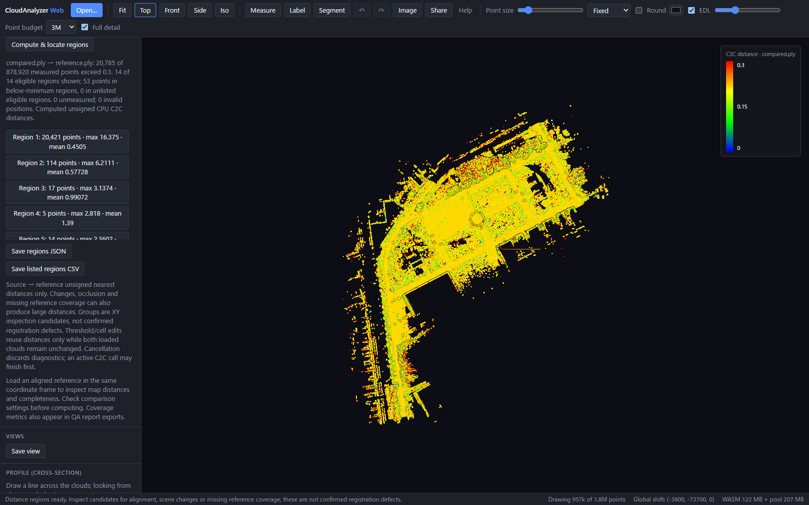
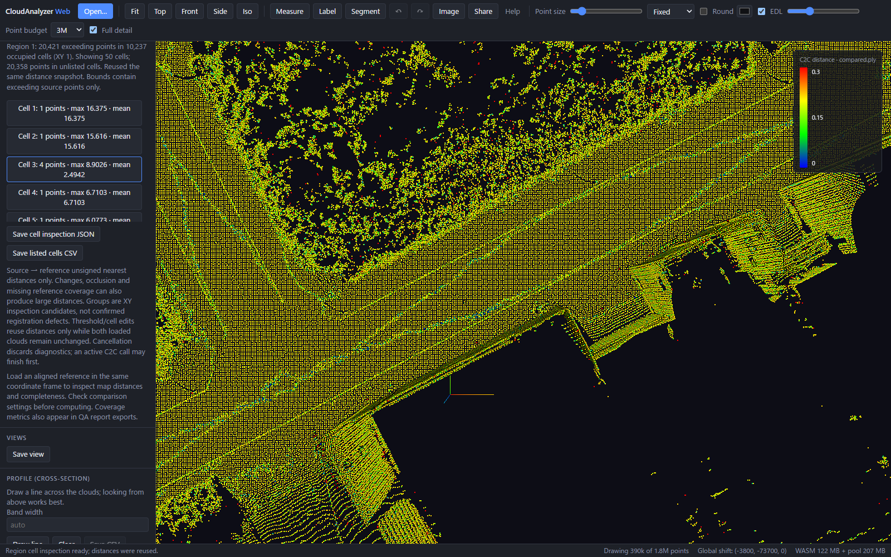
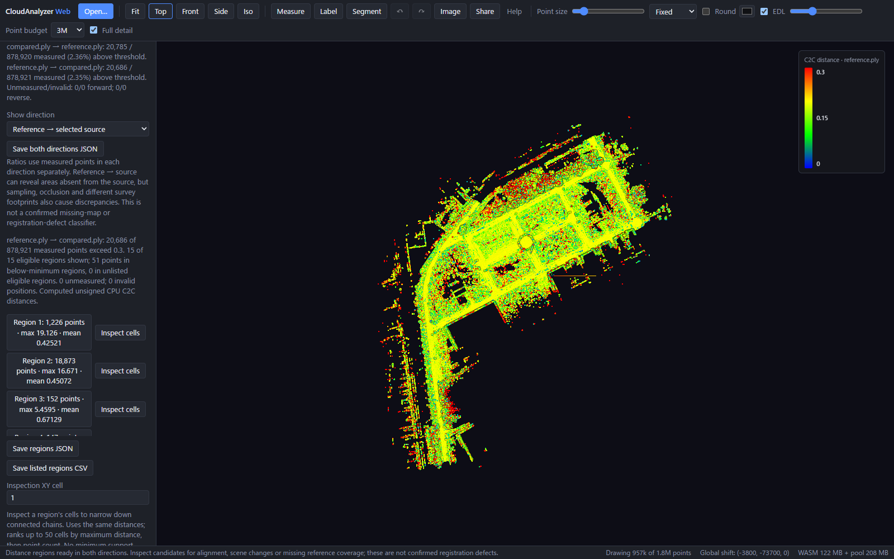
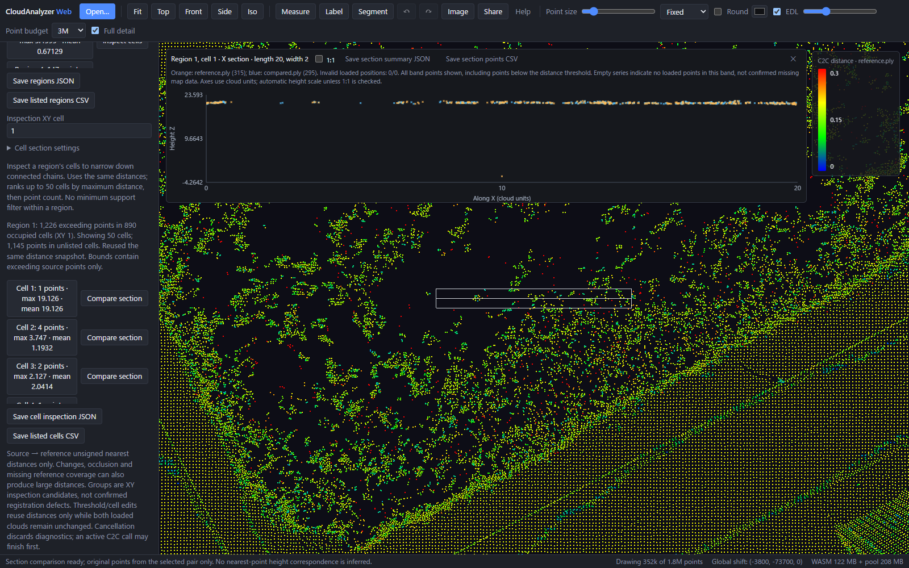

# Locate distance discrepancy regions

In **Map coverage & quality**, select a source map and an aligned reference,
then expand **Locate distance discrepancies**. Choose a distance threshold,
grouping XY cell size and minimum exceeding points per region, and click
**Compute & locate regions**.

Use **Compare both directions** to compute source → reference and reference →
source sequentially with the same settings. The summary shows exceeding and
measured counts, their ratio, and unmeasured/invalid counts separately for each
direction. Ratios exclude unmeasured/invalid rows; without measured points the
ratio is unavailable. **Show direction** switches the heatmap, region list and
cell inspection to the corresponding source cloud without rerunning distances.
Switching direction clears the previous cell inspection. **Save both directions
JSON** retains both source identities, full counts, settings and listed regions;
the existing region JSON/CSV exports apply to the currently shown direction.
QA reports retain both-direction counts as well as the shown direction's detail.

Each direction caches its own distances for the exact input snapshots. Starting
with a one-direction diagnosis reuses that direction and computes only the
missing reverse distances. Threshold/grouping edits can reuse both snapshots.
The both-direction result is published only after both directions finish and
remain valid; cancellation or input/settings changes publish neither partial
diagnosis. Running **Compute & locate regions** returns to one-direction output.
Both-direction mode requires XYZ plus distances to fit within 64 MiB for each
cloud, rather than the reference-XYZ-only limit of one-direction mode.

Under **Expected overlap area**, enable **Limit comparison to a world XY
rectangle** and enter all four bounds in the clouds' original coordinates.
Only finite query points inside that closed rectangle contribute to measured,
unmeasured, exceeding and region counts. Both directions use the same physical
rectangle, with each cloud's own coordinate shift. All heights are included.
The rectangle is supplied by the user; it does not establish that both surveys
actually covered the area.

Outside finite positions are counted as `outsideOverlap`, even when their
distance is unknown. Invalid XYZ records remain in `invalidPositions`; the
accounting is `points = measured + unmeasured + outsideOverlap + invalidPositions`.
An empty review area has no measured points and an unavailable exceedance ratio,
rather than a zero-error score. JSON retains `overlap` as
`[minX, minY, maxX, maxY]` (or `null` for the full cloud), and QA reports retain
the bounds and excluded counts. CSV exports contain only listed scoped rows;
keep JSON alongside them for scope and accounting.

Nearest-neighbor searches still use the full loaded reference, including points
outside the rectangle, so a query at its edge does not lose nearby references.
The distance colors also continue to show the full source cloud. Changing the
rectangle invalidates the diagnosis, fine-cell inspection, section and report,
but can reuse unchanged distance snapshots. Fine cells retain exactly the
scoped component's points, including when excluded points share a coarse cell.
The grid origin remains the full finite source XY minimum. Scope does not
reduce C2C input/memory limits. Section bands remain full-pair context and can
extend outside the rectangle; section JSON records the parent
`comparisonOverlap` separately.

The tool computes existing unsigned CPU C2C nearest-neighbor distances from the
loaded source to the loaded reference. Points strictly above the threshold are
grouped into eight-neighbor-connected XY cells, ranked by maximum distance,
then exceeding-point count. Click a row to frame its source-coordinate bounds.
The mean is over exceeding points in that region, not all points in its box.
Cell size controls grouping; connected chains can form a broad region spanning
much of a map. This is not object segmentation, and different heights can join.

For a broad region, set **Inspection XY cell** (positive and no larger than the
grouping cell), then click its **Inspect cells** button. This reuses the same
distance snapshot and regroups only exceeding points belonging to that exact
connected component. A different component inside its bounding box is excluded.
Fine cells are independent bins, so adjacent cells do not merge into another
broad chain. The XY origin is the minimum finite source XY, shared with coarse
grouping; grid indices are zero-based, with half-open cells.

The inspection ranks up to 50 occupied cells by maximum distance, then point
count, then grid X/Y. It has no minimum-support filter within a region: a lone
outlier can rank first. Click a cell row to frame its exceeding-point bounds
with surrounding context (padding at least two inspection cells or 1.1 times
its maximum distance) so an isolated source point does not fill the view alone.
The summary explicitly counts points in unlisted cells. Separate cell JSON/CSV
exports retain the parent region and settings (JSON), grid indices, counts,
maximum/mean distances and original-coordinate point bounds. Cell CSV contains
only listed rows; JSON records the grid origin and omitted-point count. These
are point envelopes, not the full grid-cell footprint. QA reports include the
current cell inspection. Editing the inspection size clears that inspection;
changing the comparison/grouping settings or either cloud clears both levels.
Cancellation stops the inspection worker and preserves the parent diagnosis.

JSON includes the pair's runtime identities, loaded/file counts and sampling
scope, settings, measured/unknown counts, total exceedances and listed regions.
CSV contains only the listed ranked regions and their original-coordinate
bounds. At most 50 eligible regions are listed/exported; counts for unlisted
eligible points and below-minimum regions remain explicit. QA reports include
the current diagnosis; changing settings or invalidating either input clears it.

Distances are reused when only grouping settings change and both exact loaded
cloud snapshots remain valid. Editing/removing/replacing either input invalidates
that cache, including when another cloud has the same name. Changing the shown
source's distance result also hides the old diagnosis. Cancelling grouping stops
its worker immediately. An active C2C call can finish before cancellation takes
effect; its diagnosis is discarded without publication.

Units are the source clouds' coordinate units; no registration or CRS conversion
is performed. The effective threshold is rounded to the precision of the stored
f32 distances and recorded in JSON. Input coordinates plus distances are limited
to 64 MiB, reference XYZ to 64 MiB, and exceeding occupied cells to 50,000. Limit
failures request a crop/coarser cell rather than silently truncating inputs.
Fine inspection has the same 50,000 occupied-cell limit and rejects an
unrepresentable or over-budget grid rather than truncating it.

After inspecting cells, use **Compare section** on a cell to plot source and
reference heights in a straight XY band centered on that cell's exceeding-point
bounds. **Cell section settings** chooses X/Y direction, length and band width
in cloud units (defaults X, 20 and 2). The section includes **all finite loaded
points inside the band**, even below the distance threshold. It uses exactly
the selected pair, including a hidden member of that pair; other visible clouds
are excluded. It does not change point positions or rerun C2C.

Orange is the current direction's source, blue its reference. The plot uses
distance along the line and original-coordinate height Z; height is automatically
scaled unless **1:1** is checked. The 3D view frames the section and shows its
band rectangle and centerline at the selected cell's center height. The existing
manual profile remains separate. Empty series have count zero and no height
range; they are not filled, matched or interpreted as confirmed missing data.
Points include the band edges and line endpoints. There is no nearest-point
height correspondence, signed height-error estimate or registration-accuracy
score. Different surfaces or sampling can appear in the same band.

**Save section summary JSON** records both runtime identities, loaded/sampled
scope, cell bounds, section settings, selected/invalid counts and height ranges.
**Save section points CSV** saves every plotted original XYZ with distance along
the line and numeric cloud ID/role; names remain in JSON. Current section counts
also appear in QA reports. Closing it, editing section settings, switching
direction, invalidating the cell diagnosis or changing either cloud clears its
plot, overlay and QA data. Computation uses a separate cancellable worker;
cancellation publishes no partial result. Combined pair XYZ must fit within
64 MiB and each series within 50,000 selected points, otherwise shorten/narrow
the section or crop the pair. No silent sampling or output truncation is used.

**Large distances are inspection candidates, not confirmed registration defects.**
Scene changes, occlusion, sparse sampling and missing reference coverage can all
produce them. This direction does not locate points missing from the source;
use **Compare both directions** or swap the pair to inspect the reverse direction.
Reference → source can expose reference areas absent from the source, but this
is not proof of missing map data without an expected common survey footprint.
It does not use signed M3C2
distances or their significance tests. Use an expected overlap/survey footprint
and source inspection before attributing a cause.

The [recorded smoke check](../benchmarks/map-coverage/distance-regions.json)
uses unchanged alternating-index subsets of one Autoware planning survey:
878,920 source and 878,921 reference points. With threshold 0.3, XY cell 5 and
minimum support 5, there are 20,785 exceeding points, 40 components and 14 eligible
regions; 53 points belong to below-minimum components. The largest region links
20,421 points across much of the map. These results are a data-handling/review
check, not evidence of 14 registration failures or an independent survey.

The [cell inspection receipt](../benchmarks/map-coverage/distance-region-cells.json)
records the same largest component inspected with a 1-unit XY cell: 20,421
exceeding points in 10,237 occupied cells. The top 50 cells contain 63 points;
20,358 points remain explicitly unlisted. The highest-ranked cell is a single
point with distance 16.375; its focused view includes nearby context. This shows
why maximum-distance ranking requires source inspection and is not a defect
classifier. The earlier region receipt remains bound to its original commit.

The [both-direction receipt](../benchmarks/map-coverage/bidirectional-regions.json)
records the same pair and defaults: forward has 20,785/878,920 measured points
above threshold (2.3648%), 40 components and 14 eligible regions; reverse has
20,686/878,921 (2.3536%), 42 components and 15 eligible regions. No positions or
distances are unknown in this check. The workflow first computes forward regions,
inspects a cell, then adds reverse comparison with two C2C calls in total.
Source-file hashes remain unchanged. These ratios describe this partition pair,
without measuring independent-survey completeness or registration accuracy.

The [section receipt](../benchmarks/map-coverage/distance-section.json) follows
the reverse comparison into region 1/cell 1 using the default X band of length
20 and width 2. It plots 315 points from `reference.ply` in orange and 295 from
`compared.ply` in blue, with no invalid positions. One source outlier lies well
below the nearby surface; the plot keeps that raw height rather than assigning
a height match or diagnosing its cause. The whole workflow still uses two C2C
calls. Input file hashes are unchanged. This is an inspection example from
partitions of one survey, without measured defect-classification accuracy.
