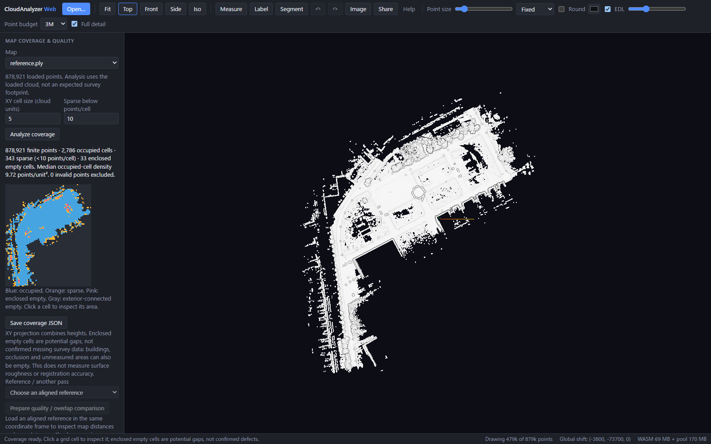

# Inspect map coverage and density

Open or build a point cloud, then use **Map coverage & quality**. Choose a map,
an XY cell size in its coordinate units, and the minimum points per occupied
cell. **Analyze coverage** computes a grid without modifying points or adding a
derived cloud. **Analyze latest cloud…** beside Build map cloud opens this panel
with the latest loaded point cloud selected.

- **Blue:** occupied cells meeting the chosen point-count threshold.
- **Orange:** occupied cells below that threshold.
- **Pink:** empty cells disconnected from the grid boundary through eight-neighbor
  empty-cell paths. These are potential gaps to inspect.
- **Gray:** empty cells connected to the exterior.

Click a cell to focus its area in the viewer. Save the summary as coverage JSON,
or include its metrics in the existing QA JSON/HTML report. Editing the source,
changing settings or removing the source invalidates the result and report
metrics; rerun analysis to get current values.

This is an **XY projection of all loaded finite XYZ records**. Multiple heights
and duplicate returns contribute to the same cells. Density is points per square
coordinate unit, measured over occupied cells; it is not a surface-area density.
The grid starts at the loaded finite XY minimum and uses half-open cells.
Display LOD does not reduce the analysis input, but file-loading thinning and
COPC previews do: the panel and JSON explicitly record that loaded-point scope.

Enclosed empty cells are not confirmed survey defects. Buildings, occlusion and
unsurveyed space can also produce them. The sparse threshold is user-defined;
there is no automatic quality score or roughness/registration-accuracy estimate.
To inspect overlap shifts, choose an aligned reference or another pass and use
**Prepare quality / overlap comparison**. This selects the existing map-quality
tool; review the threshold/voxel settings before computing, or select C2C/M3C2.

[Distance discrepancy regions](distance-regions.md) adds ranked candidate areas,
click-to-focus inspection and CSV/JSON exports for unsigned source-to-reference
distances, with reuse while the same input pair remains unchanged.

[Cut/fill surface volume](surface-volume.md) uses the selected reference as
Before and source as After, with interpolation initially off. It reports added,
removed and net volume, displays signed cell-height differences, and exports
input/settings-aware JSON and compared-cell CSV. Crop surfaces to limit volume
to a site; distance-review overlap bounds apply only to distance analysis.

Processing uses a cancellable worker, up to 64 MiB of loaded XYZ coordinates,
262,144 cells and 2,048 cells per axis. Oversized requests fail with a crop/cell-size
suggestion rather than silently sampling. Cancellation or source changes never
publish a partial result.

The [recorded smoke check](../benchmarks/map-coverage/smoke.json) uses an existing
878,921-point alternating-index subset of the Autoware planning sample. At cell
size 5 and sparse threshold 10 it has 2,786 occupied cells, 343 sparse cells and
33 enclosed empty cells. These are implementation/inspection results, not
ground-truth missing-data labels or a survey-accuracy benchmark. No new dataset
download, model or raw point file is included.
