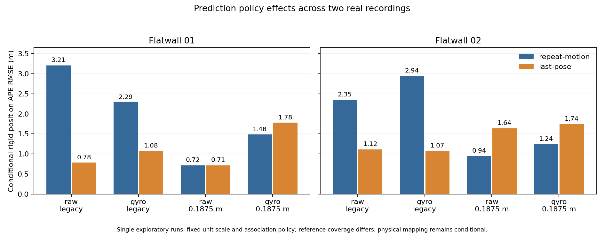

# Prediction policy on a second real Flatwall recording

All eight fixed controls were run on Flatwall02: repeat the last body motion or
start from the last pose, with raw/gyro point compensation and legacy/0.1875 m
source sampling. The last-pose policy again lowers both legacy conditional
position errors, while both fine-sampling position errors increase on 02.
There is no general replacement for the existing default in these results.



| Flatwall02 condition | Prediction | Rigid position RMSE (m) | First-pose position RMSE (m) | Adjacent translation RMSE (m) | Adjacent rotation RMSE (deg) |
| --- | --- | ---: | ---: | ---: | ---: |
| raw, legacy | repeat motion | 2.349807 | 4.748809 | 0.491164 | 17.980888 |
| raw, legacy | last pose | 1.116025 | 2.740426 | 0.151361 | 3.357672 |
| gyro, legacy | repeat motion | 2.944726 | 5.614772 | 0.334067 | 7.891426 |
| gyro, legacy | last pose | 1.073579 | 2.941643 | 0.150305 | 3.574058 |
| raw, 0.1875 m | repeat motion | 0.943776 | 3.236547 | 0.118436 | 4.240806 |
| raw, 0.1875 m | last pose | 1.636650 | 5.980250 | 0.233478 | 2.868351 |
| gyro, 0.1875 m | repeat motion | 1.241284 | 2.502037 | 0.156306 | 5.359298 |
| gyro, 0.1875 m | last pose | 1.744921 | 6.158629 | 0.244928 | 2.905521 |

The fine controls illustrate the mixed outcome: adjacent rotation error falls,
but position and adjacent translation errors rise. The earlier 01 raw fine
global position fit barely changed, whereas its gyro fine fit worsened. The
two recordings support keeping every control and checking multiple metrics.
These are single exploratory runs, not population estimates or significance
tests. Policy changes also alter later maps, thresholds and correspondences;
this is not a fixed-map decomposition of the source of error.

## Coverage and evidence boundary

The recording was selected by the next ordinal before reading its full reference.
Its original 137 scans were inspected independently. Scans 0 and 136 are outside
complete IMU coverage; all remaining 135 scans, indices 1 through 135, are retained
in every estimate. All eight trajectories, reports and 1,080 native diagnostic
snapshots were closed and hashed before full `gt/flatwall_02.txt` parsing.
Historical prefixes of all eight members and all full 01 results had already
been inspected, so this experiment is exploratory and cannot be called blind or
held out.

The fixed 100 ms reference-bracket limit leaves **114 paired estimates**:
20 estimates cross longer reference gaps and one lies after reference coverage.
All 135 estimates remain published with reasons. Relative errors and path length
use **111 consecutive original-scan edges**; neither input nor reference
exclusions are bridged. Covered-edge reference path length is 3.584649 m.

Source points and insertion voxel selection, coordinate transforms, fixed-match
weights, normal matrices, right-hand sides, support/radius and normalized spectra
were reconstructed independently for every snapshot. All first-two pose bits and
reports agree between equivalent policies; all source point counts agree across
policies. Native map matching and map evolution were not independently replayed
in this trial. The legacy raw/gyro controls retain 40/41 insufficient-point stops
per policy, plus each empty-map anchor. Fine controls retain only their anchors.
All supported normalized spectra remain above the old diagnostic weak-ratio
threshold; no new gate is inferred from that result.

The [input provenance audit](slam-flatwall-input-provenance.md) documents the
author-configured scale, offset and extrinsic, and the rounded-header/integer-
timebase distinction. This experiment keeps the prior header-plus-integer-offset
scan-end convention. It assumes the same TUM syntax, reference-world-from-LiDAR,
zero reference offset, identity reference body mapping and unit scale. Exact
int64 timestamps, no extrapolation, proper rigid position fit with rank guard,
first-pose alignment and original-edge accounting are unchanged. These assumptions
do not certify physical calibration or archive-specific reference conventions.

## Reproduce the public arithmetic

```sh
python benchmarks/slam/flatwall02-prediction/verify.py
python -m pytest cloudanalyzer/tests/test_flatwall_recording_prediction.py cloudanalyzer/tests/test_flatwall_recording_prediction_packet.py -q
```

The packet includes the original selected reference text verbatim, its member
hash, derived paired reference matrices, all eight complete estimates/reports,
coverage and edge rows, frame diagnostics and snapshot hash catalog. Creator,
source and CC BY 4.0 attribution appear in `attribution.json`.

The public verifier uses exact rational timestamp conversion and an independent
quaternion interpolation implementation to reconstruct association. It recomputes
all eight trajectory metrics, fits, original edges, spectra and policy invariants.
A separately frozen controller checked Decimal association/local rotation
interpolation and installed evo APE/RPE/no-scale Umeyama arithmetic. Public
verification does not redo raw native snapshot/map-search checks or supply
missing physical provenance. The original native binary/package and all 113
archived build inputs were preserved; no native rebuild, estimator default,
initializer acceptance, GLIM-equivalence or runtime/GPU claim is introduced.
