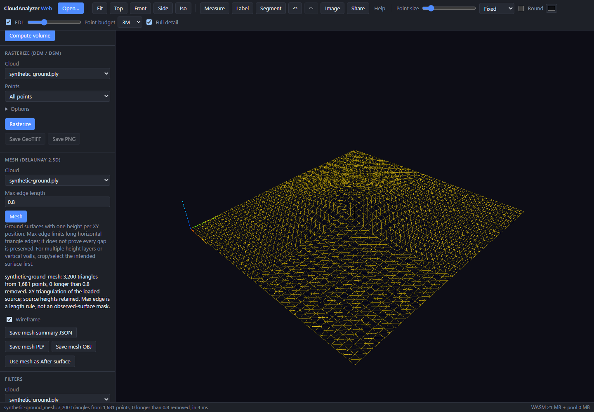

# Mesh a ground surface

Select a ground cloud in **Map coverage & quality**, then choose **Prepare terrain
mesh**. In **Mesh (Delaunay 2.5D)** review the source and maximum edge length,
then choose **Mesh**. The source is hidden and the derived mesh is displayed;
one Undo restores the source. Cloud-list checkboxes control their visibility.

This illustration uses synthetic terrain, not an observed survey.

The existing engine triangulates XY positions and retains source heights. Use
a surface with one height per XY position. Crop or extract ground first when
the input contains vegetation, roofs, walls or several height layers. This is
terrain triangulation, not full 3D reconstruction or automatic ground selection.

- Empty max edge: automatic, four times the median triangulation edge length.
- Positive max edge: drop triangles with any longer horizontal edge, in the
  coordinate units of the input.
- Zero: retain the whole triangulated convex hull, including bridges over gaps.

Inspect the result in **Wireframe**. An edge limit can remove long bridges but
does not define the observed footprint or guarantee that every hole stays open.
Short bridges can remain. Reduce the limit or crop the source as appropriate;
too small a limit can remove real surface triangles.

**Save mesh OBJ** and **Save mesh PLY** export vertices and triangle faces in
original coordinates. Wireframe affects only the view; exports retain faces.
**Save mesh summary JSON** records exact runtime source/output identities,
loaded/file counts and preview scope, requested/effective edge limits, vertex
and triangle counts, removed triangles and voxel thinning. Keep it with the
geometry export. The QA report also includes the current mesh summary.

Only loaded points are meshed; file-loading sampling and COPC previews limit
the available surface. The existing engine voxel-thins sources above 5,000,000
points before triangulation. The displayed counts, voxel size and JSON expose
this processing; this workflow is not out-of-core meshing of a full huge map.

After a [cut/fill comparison](surface-volume.md), **Mesh compared After cells**
prepares its derived cell cloud for meshing. These are the compared grid-cell
centers at **After height**, not the full later survey or a mesh of signed change.
The volume JSON records that cloud's identity so it can be matched to the mesh
summary. Signed change colors are not transferred to mesh vertices.

**Use mesh as After surface** prepares the existing volume tool with that mesh
and interpolation off. Review Before, cell size and coordinate unit before
calculating. Grid sampling and missing cells affect the estimate; this remains
a 2.5D height-volume calculation, not closed-solid volume.

Changing the source, edge settings or input/output geometry clears the current
receipt and QA metrics. A cancelled or changed request discards and releases
its unpublished mesh after the active triangulation finishes. Publication needs
enough Memory and Undo capacity for one step; otherwise the source remains
visible and the staged mesh is released.

The production-browser regression uses two known sloped 3 × 3 ground patches
separated by an eight-unit gap. At max edge 1.5 it retains 18 vertices and 16
triangles (eight per patch), checks every exported horizontal edge and source
height, and verifies real wireframe rendering, OBJ/PLY exports and Undo. Separate
cases cover unlimited hull bridging, invalid settings, cancellation, source
replacement, Undo limits and compared-cell mesh/volume handoff. These checks
validate geometry and workflow; they are not a survey-accuracy benchmark.
The [browser validation record](../benchmarks/map-coverage/terrain-mesh.json)
records the tested sources and results.
